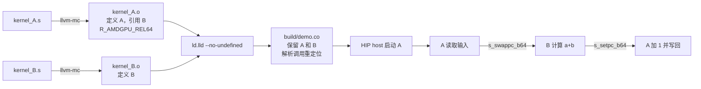

# ASM A 调用 ASM B：分别汇编，再链接

这个最小实验面向 **gfx1250 / wave32**。`kernel_A.s` 和 `kernel_B.s` 独立汇编成可重定位 ELF 目标文件，随后由 `ld.lld` 链接成一个 AMDGPU HSA code object。A 中保留真正的设备函数调用，B 的机器指令保存在独立的函数体中。

A 是 host 可以启动的 kernel。B 是由 A 调用的 leaf device function，保留了 `kernel_B` 这个名字，但没有 kernel descriptor，也不会发起第二次 dispatch。B 在 A 已有的 wave、EXEC mask 和线程上下文中执行。

计算内容刻意保持简单，使用 `uint32_t`，溢出按模 2^32 处理：

```cpp
// 对应 kernel_B.s；参数、返回值通过约定的寄存器传递。
uint32_t B(uint32_t a, uint32_t b) {
    return a + b;
}

// 对应 kernel_A.s；只启动一个 block，block size 为 1..256。
__global__ void A(const uint32_t* a, const uint32_t* b, uint32_t* out) {
    uint32_t t = threadIdx.x;
    uint32_t sum = B(a[t], b[t]);
    out[t] = sum + 1;
}
```

返回后由 A 再加 1，可以区分“只执行 B 的结果”和“返回 A 继续计算”。

## 文件与构建产物

| 文件 | 作用 |
|---|---|
| `kernel_A.s` | 可启动入口、内存读写、对 B 的调用、A 的 descriptor/metadata |
| `kernel_B.s` | 独立汇编的加法函数，使用 `s_setpc_b64` 返回 |
| `Makefile` | 两条独立汇编规则、一条链接规则；默认不运行测试 |
| `test.cpp` | 可选 HIP host 测试，只加载最终 code object 并启动 A |
| `verify.py` | 可选离线 ELF 检查，检查重定位、调用地址、函数字节和 descriptor |



在本目录执行：

```bash
# 先分别生成两个二进制目标文件。
make objects

# 只链接已有目标文件；不会启动 GPU。
make

# 导出符号表、重定位和反汇编；不执行测试。
make inspect

# 只编译 host 测试程序，不运行。
make host
```

核心命令等价于：

```bash
mkdir -p build
/opt/rocm/lib/llvm/bin/llvm-mc \
    -triple=amdgcn-amd-amdhsa -mcpu=gfx1250 \
    -mattr=+wavefrontsize32,+real-true16 -filetype=obj \
    kernel_A.s -o build/kernel_A.o
/opt/rocm/lib/llvm/bin/llvm-mc \
    -triple=amdgcn-amd-amdhsa -mcpu=gfx1250 \
    -mattr=+wavefrontsize32,+real-true16 -filetype=obj \
    kernel_B.s -o build/kernel_B.o
/opt/rocm/lib/llvm/bin/ld.lld \
    -shared --no-undefined --build-id=none \
    build/kernel_A.o build/kernel_B.o -o build/demo.co
```

可以通过 `LLVM=/path/to/llvm/bin`、`ROCM_PATH=/path/to/rocm` 和 `BUILD=other_build` 覆盖路径。

`kernel_A.o` 和 `kernel_B.o` 是 `ET_REL` 文件；链接的 `demo.co` 是 `ET_DYN` 文件。`.o` 中的指令已经是二进制机器码，但对外部函数的地址引用仍需要链接器填入。

## 参数、返回值与保存约定

这个实验全部手写 ASM，使用下面这套小型约定。它没有宣称实现完整的 LLVM CCC ABI。

| 寄存器 | A 调用 B 时的含义 |
|---|---|
| `v2` | 第一个输入 `a[t]`；返回后是 `a[t]+b[t]` |
| `v3` | 第二个输入 `b[t]`，B 保持它不变 |
| `s[16:17]` | A 计算出的 B 的 64 位地址 |
| `s[30:31]` | `s_swappc_b64` 写入的返回地址 |
| `v1` | A 的元素字节偏移，B 必须保留 |
| `s[8:9]` | A 的输出指针，B 必须保留 |

B 只修改 `v2`，保留其他数据寄存器、EXEC、VCC、SCC 和 VGPR bank/MODE 状态。A 进入时明确设定 VGPR bank 0，并在调用前等待输入读取完成；结果写回前也加入保守的依赖等待。

A 的 host 参数是三条 64 位指针，kernarg 总长度为 24 字节：`a` 在偏移 0、`b` 在偏移 8、`out` 在偏移 16。A 的 dispatch 入口收到 `s[0:1]=kernarg address`、`v0=threadIdx.x`，然后读取这些指针。

## 跨目标文件的调用如何实现

A 中的核心代码是：

```asm
    s_getpc_b64 s[16:17]
    s_add_nc_u64 s[16:17], s[16:17], kernel_B@rel64+4
    s_swappc_b64 s[30:31], s[16:17]

    // B 返回后的第一条指令。
    v_add_nc_u32 v2, v2, 1
```

B 的完整计算和返回只有两条指令：

```asm
kernel_B:
    v_add_nc_u32 v2, v2, v3
    s_setpc_b64 s[30:31]
```

1. `s_getpc_b64` 得到下一条 `s_add_nc_u64` 指令的地址。
2. `kernel_B@rel64+4` 让汇编器生成 `R_AMDGPU_REL64` 重定位。A 单独汇编时不知道 B 的地址，在符号表中把 B 记为未定义符号。
3. 链接器从 B.o 找到 B 的定义，将 `S + addend - P` 写入 A 的 64 位 literal。其中 `S` 是 B 的地址，`P` 是 literal 的地址，addend 是 4。
4. 这里 `P` 比 `s_getpc` 得到的地址大 4，因此加上填好的 literal 恰好得到 B 的地址。整个结果随 code object 一起移动，调用地址不依赖某个固定加载基址。
5. `s_swappc_b64` 保存下一条指令的地址到 `s[30:31]`，跳转到 B。
6. B 的 `s_setpc_b64` 从 `s[30:31]` 恢复 PC，继续 A 的加 1 和写回。

gfx1250 反汇编可能显示新版别名：`s_get_pc_i64`、`s_swap_pc_i64`、`s_set_pc_i64`。它们对应这里源文件中的三条 PC 指令。

`.protected kernel_B` 使最终文件内部对 B 的引用绑定到本文件的定义。`--no-undefined` 要求所有外部引用都在链接时解决。B 不会被插入 A 的函数体；链接后仍能看到独立的 `kernel_B` 符号。

## 本次实际构建记录

2026-11-13 使用本机 `/opt/rocm/lib/llvm/bin`，AMD LLVM 22 / ROCm 7.2.0，执行了分别汇编、链接、ELF/反汇编导出，以及 host 程序编译。**没有执行离线测试脚本或 GPU 测试。**

可以直接查看这些产物：

| 产物 | 已观察到的内容 |
|---|---|
| `build/kernel_A.elf.txt` | A.o 为 `REL`；B 为 `UND`；`.rela.text` 有 `R_AMDGPU_REL64 kernel_B + 4` |
| `build/kernel_B.elf.txt` | B.o 为 `REL`；定义 `kernel_B`；B 函数体为 8 字节 |
| `build/demo.elf.txt` | 最终文件为 `DYN`；A、B 均已定义；没有剩余重定位 |
| `build/demo.disasm.txt` | A 中有 PC 调用，B 中有 PC 返回，A 返回位置有加 1 |
| `build/test` | 已编译的 host 测试程序，尚未运行 |

当前构建将 A 的指令入口设置为 16 KiB 对齐：在 `kernel_A:` 标签前使用 `.p2align 14`（2^14 = 16384 字节）。`.balign 16384` 是按字节指定的等价写法。这个指令设置代码入口的对齐，descriptor 仍使用原有的 64 字节对齐。

重新汇编、链接后，ELF 中 `.text` 的对齐值为 16384，代码所在 LOAD segment 的 `p_align` 为 `0x4000`，A 的链接地址为 `0x4000`。ELF 表达了 16 KiB 加载对齐要求；本次没有执行 GPU 加载地址检查。可以用 `llvm-readelf -l -S build/demo.co` 查看段与 section 的对齐。

当前构建中，A 位于 `0x4000`，B 位于 `0x4200`。`s_getpc` 得到的下一条指令地址为 `0x404c`，链接后 literal 为 `0x1b4`：

```text
0x404c + 0x1b4 = 0x4200 = kernel_B
```

这些地址是 code object 内的当前布局；增加指令、改变对齐或链接顺序后可以变化，重定位会跟着重新计算。

## 可选测试与边界

需要执行测试时使用：

```bash
make check          # 离线 ELF 检查，无 GPU 执行
make run            # 加载 demo.co，在 gfx1250 上运行
make run DEVICE=0   # 显式选择 HIP 设备编号
```

离线检查包括：两个 `.o` 独立；A 引用 B；最终重定位全部解决；B 的机器码与 B.o 一致；A 只改变重定位位置；计算出的调用目标恰好是 B；kernel descriptor 指向 A。

GPU 测试使用 1、13、32、64、256 个线程，每种线程数覆盖普通数值、32 位溢出和确定性伪随机输入，并逐元素比较 `out=a+b+1`、检查输入和输出 guard。只 dispatch A。

这个最小例子只支持一个 block，B 没有递归、嵌套调用、scratch 或 LDS。扩展时需要显式约定参数和 clobber；嵌套调用要保存原来的返回 PC。**A 的 descriptor 必须覆盖整条调用链的 VGPR/SGPR、scratch、LDS 等资源，链接器不会自动合并这些预算。** 本例 A 设置 4 个 VGPR 和 32 个 SGPR 的逻辑使用上界，包含 B 以及返回地址寄存器；硬件分配按架构粒度取整。
