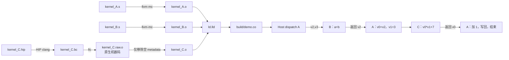

# ASM A 先调用 ASM B，再调用 HIP C

本目录从 `../asm_test00` 复制 A/B 的 ASM 和测试，在 **gfx1250 / wave32** 上增加 HIP 编写的 C。三个函数先分别编译成原生 ELF `.o`，然后链接为一个 code object。

A 是 host 启动的 kernel；B 和 C 是 A 调用的设备函数。C 使用 HIP `__device__`，按普通 device-function ABI 编译，和 A 的 wave/EXEC 共享线程上下文。

```cpp
uint32_t B(uint32_t a, uint32_t b) {       // kernel_B.s
    return a + b;
}

__device__ uint32_t C(uint32_t value, uint32_t multiplier) {
    return value * multiplier + 7u;       // kernel_C.hip
}

__global__ void A(const uint32_t* a, const uint32_t* b, uint32_t* out) {
    uint32_t t = threadIdx.x;             // 一个 block，1..256 线程
    uint32_t sum = B(a[t], b[t]);
    uint32_t scaled = C(sum, 3u);
    out[t] = scaled + 1u;                 // 3*(a[t]+b[t])+8，模 2^32
}
```

A 在 C 返回后加 1，沿用 `asm_test00` 的返回后继续计算方式。

## 文件

| 文件 | 作用 |
|---|---|
| `kernel_A.s` | ASM 入口，读输入、调用 B、准备 C 的参数、调用 C、写回结果；提供唯一 kernel descriptor/metadata |
| `kernel_B.s` | 从 `asm_test00` 原样复制的 ASM 加法设备函数 |
| `kernel_C.hip` | HIP 的整数乘加设备函数，`extern "C"` 保持符号名，`noinline` 保留函数 |
| `Makefile` | 三个独立原生对象的编译和链接；默认只构建 |
| `audit_c.py` | 构建阶段检查 C 实际生成的寄存器接口、返回、资源和空 metadata |
| `test.cpp` | 复制并更新的 HIP host 测试，比较新公式并检查输入/输出 guard |
| `verify.py` | 复制并扩展的可选离线检查，覆盖 B、C 两条重定位、函数字节及唯一 metadata |

## 构建与调用流程



执行：

```bash
cd /home/feifei/repo/ATOM/asm_test01
make objects    # 分别生成 A.o、B.o、C.o；不会运行测试
make            # 将三个原生对象链接成 build/demo.co
make inspect    # 导出 ELF 和反汇编，方便查看调用和重定位
make host       # 只编译 host 测试程序
```

可覆盖 `ROCM_PATH`、`LLVM`、`BUILD`，默认工具为 `/opt/rocm/lib/llvm/bin`。

HIP 的 RDC device-only 编译中，`clang++ -c` 可以输出 LLVM bitcode。因此构建明确先生成 `.bc`，再由 `llc -filetype=obj` 生成 **原生 ET_REL ELF**，传给 `ld.lld` 的是三个二进制目标文件：

```bash
# C 的 HIP 前端编译。
/opt/rocm/lib/llvm/bin/clang++ \
    -x hip --cuda-device-only --offload-arch=gfx1250 --rocm-path=/opt/rocm \
    -fgpu-rdc -mcode-object-version=6 -mno-wavefrontsize64 \
    -O2 -emit-llvm -c kernel_C.hip -o build/kernel_C.bc

# LLVM 后端生成 C 的原生对象。另有一条相同后端配置的 ASM 导出用于 ABI 检查。
/opt/rocm/lib/llvm/bin/llc \
    -mtriple=amdgcn-amd-amdhsa -mcpu=gfx1250 \
    -mattr=+wavefrontsize32,+real-true16 -O2 -filetype=obj \
    build/kernel_C.bc -o build/kernel_C.raw.o

# Makefile 先检查 C 的 ABI 和 metadata，再执行此步骤。
/opt/rocm/lib/llvm/bin/llvm-objcopy --remove-section=.note \
    build/kernel_C.raw.o build/kernel_C.o

# A.o/B.o 分别通过 llvm-mc 从 ASM 生成。
/opt/rocm/lib/llvm/bin/ld.lld -shared --no-undefined --build-id=none \
    build/kernel_A.o build/kernel_B.o build/kernel_C.o -o build/demo.co
```

C 的机器指令没有被提取到 A，也没有寄存器重映射或返回改写。原生 C 函数以独立符号保留。

### 为什么需要 `llc`

`llc` 是 LLVM 的后端编译器：输入 LLVM IR（`.ll` 文本或 `.bc` bitcode），输出目标机器的汇编（`.s`）或目标文件（`.o`）。它只负责编译器后半段，即指令选择、寄存器分配、调度和指令编码，不处理 HIP/C++ 源码。

| 工具 | 输入 | 输出 |
|---|---|---|
| `clang++` | HIP/C++ 源码 | LLVM IR，或者完整走完后端得到机器码 |
| `llc` | LLVM IR | 汇编或目标文件 |
| `llvm-mc` | 手写汇编 | 目标文件，只做编码，不做优化和寄存器分配 |
| `ld.lld` | 多个 `.o` | 最终 code object |

`asm_test00` 全是手写汇编，只用 `llvm-mc` 就够了。嵌入 HIP 后需要 `llc`，原因是 `ld.lld` 要的是一个**可重定位目标文件**（ELF 类型 `REL`），里面放着已经编码好的 C 的机器码，等待和 A、B 链接。而 HIP 的常规编译给不出这样的文件：

- **不加 `-fgpu-rdc`**：clang 直接链接出完整的 code object（`DYN`），不能再和其他 `.o` 链接。
- **加 `-fgpu-rdc -c`**（本例的可分离编译模式）：clang 输出的是 LLVM bitcode。设备代码的机器码生成被推迟到链接时统一完成，所以 `kernel_C.bc` 里还没有 gfx1250 指令。

因此 Makefile 用 `llc` 把 `kernel_C.bc` 编成 `kernel_C.raw.o`（`REL`，真正的 gfx1250 指令），再交给 `ld.lld`。另外用同样的后端配置导出 `kernel_C.native.s`，供 `audit_c.py` 检查 C 的寄存器接口。

`llc` 不是必须的：clang 内部有同一个后端，可以直接编译 bitcode。

```bash
/opt/rocm/lib/llvm/bin/clang -target amdgcn-amd-amdhsa -mcpu=gfx1250 -mcode-object-version=6 -O2 \
    -c build/kernel_C.bc -o build/kernel_C.raw.o     # 审计用的汇编：把 -c 换成 -S
```

2026-11-13 在本机实测，这条命令得到的也是 `REL` 文件，`kernel_C` 的四条指令与 `llc` 的输出完全相同。有些 ROCm 安装（例如本机的 `/opt/rocm/lib/llvm/bin`）没有附带 `llc`，可以用这种方式代替。

## B 的自定义接口和 C 的编译器接口

| 接口 | 输入 | 返回结果 | 返回地址 |
|---|---|---|---|
| A → ASM B | `v2=a[t]`、`v3=b[t]` | `v2` | `s[30:31]` |
| A → HIP C | `v0=B 的结果`、`v1=3` | `v0` | `s[30:31]` |

A 从 B 返回后执行参数转换，并重新建立 C 的返回地址：

```asm
// B 已返回，v2=a+b。
v_mov_b32 v0, v2
v_mov_b32 v1, 3
s_waitcnt_depctr 0
s_nop 7
s_getpc_b64 s[16:17]
s_add_nc_u64 s[16:17], s[16:17], kernel_C@rel64+4
s_swappc_b64 s[30:31], s[16:17]

// C 返回到这里，结果在 v0。
v_add_nc_u32 v0, v0, 1
```

两个调用按先后顺序执行，B 已返回后才覆盖 `s[30:31]`，无需嵌套调用的返回地址栈。

本机 AMD LLVM 22 给 C 生成的实际函数体是：

```asm
kernel_C:
    s_wait_loadcnt_dscnt 0x0
    s_wait_kmcnt 0x0
    v_mad_u32 v0, v1, v0, 7
    s_set_pc_i64 s[30:31]
```

`audit_c.py` 在构建时检查这段实际代码，确认输入/输出寄存器、计算指令、返回及资源符合当前 A 的接口。它是这个小例子的严格构建约束；更换 C 的算法或 LLVM 版本后，如果代码变化，构建会要求重新审阅接口和资源。

A 的输出指针保存在 `s[36:37]`，元素字节偏移保存在 `v40`。它们是当前普通 AMDGPU device ABI 的 callee-saved 寄存器，用于跨 C 保留状态。当前 C 只写 `v0`，未触碰这些寄存器。

## 资源与 metadata

A 的 descriptor/metadata 覆盖整个调用链：

```text
A：最高使用 v40、s37
B：使用 v2/v3 和返回 PC s[30:31]
C：编译报告 num_vgpr=2、numbered_sgpr=32，scratch=0、VCC=0

A 的声明：next_free_vgpr=41、next_free_sgpr=38
LDS=0，scratch=0，wave32
```

实际硬件寄存器分配按架构粒度取整。链接器不会把 C 的资源自动加进 A 的 descriptor。

当前 `llc` 即使只编译 `__device__` 函数，也会生成 `.note` 中的空 kernel metadata：

```yaml
amdhsa.kernels: []
```

构建先确认 C 没有 kernel descriptor、metadata 列表为空、没有外部引用，再从 C 的 **已编译对象** 中移除这份 note。A 提供最终唯一的 metadata，描述可启动的 `kernel_A`。B/C 都通过代码符号地址调用。

HIP 的标准 device 编译还生成了未被调用的弱虚函数辅助符号和 `__hip_cuid_*` 数据符号；它们可能保留在 ELF 中，不参与 A→B→C 的计算路径。

## 复制和扩展的测试

测试只在显式执行以下命令时运行：

```bash
make check          # 离线 ELF 检查，不启动 GPU
make run            # 在 gfx1250 上加载 demo.co 并启动 A
make run DEVICE=0   # 显式选择 HIP 设备编号
```

`test.cpp` 沿用原测试的 1、13、32、64、256 线程，以及普通数值、uint32 溢出、确定性伪随机输入。CPU 参考使用 64 位中间结果，最后转为 uint32，比较 `3*(a+b)+8`，同时检查输入不变、输出两侧 guard 不变。

`verify.py` 扩展检查：

- A/B/C 都是独立的原生 ET_REL 对象，最终文件为 ET_DYN。
- A.o 中先出现对 B 的调用重定位，再出现对 C 的调用重定位。
- 两条 REL64 literal 在链接后分别解析到 B、C 的最终地址。
- B/C 的函数机器码与各自 `.o` 一致；移除 C 的 note 不改变 C 的函数体。
- A 的机器码只在两处重定位 literal 改变。
- 最终重定位全部解决；只有 A 有 kernel descriptor，只有一份 HSA kernel metadata。
- A 的 descriptor 指向 A；metadata 寄存器预算匹配本例。

## 本次构建记录与范围

2026-11-13 使用本机 AMD LLVM 22 / ROCm 7.2.0，已执行 `make objects`、`make`、`make inspect`、`make host`，以及构建中必需的 C ABI 检查。**没有执行 `make check`、`make run` 或 GPU 测试。**

产物位于 `build/`：

| 产物 | 内容 |
|---|---|
| `kernel_A.o`、`kernel_B.o`、`kernel_C.o` | 三个独立的原生二进制目标文件 |
| `kernel_C.bc` | HIP 前端生成的 bitcode，不直接作为本例最终链接输入 |
| `kernel_C.native.s`、`kernel_C.abi.json` | 实际后端 ASM 和构建 ABI 检查记录 |
| `demo.co` | 链接后的 code object |
| `kernel_A.elf.txt` | B/C 两条 `R_AMDGPU_REL64` 重定位 |
| `demo.elf.txt`、`demo.disasm.txt` | 最终符号、唯一 metadata，以及两个调用和返回 |
| `test` | 已编译、未执行的 host 测试程序 |

当前链接中 A=`0x1700`，B=`0x1a00`，C=`0x1c18`。两次 PC 基址和重定位结果分别满足：

```text
B：0x174c + 0x2b4 = 0x1a00
C：0x1770 + 0x4a8 = 0x1c18
```

链接布局可以变化，地址由重定位重新计算。本例仅支持一个 block 和当前简单的、无 scratch/嵌套调用/隐式 dispatch 参数的 C。

## 2026-11-13 另一台机器上的验证记录（AMD LLVM 23）

在 `/app/ATOM/asm_test01` 执行了构建、`make check` 和 `make run`，**离线检查和 GPU 测试都通过**：

```text
HIP C build ABI: v0/v1 -> v0, return s[30:31], no scratch; empty metadata identified
Static PASS: independent ASM A/B and HIP C native objects; both call relocations resolved
GPU 1: AMD Radeon Graphics (gfx1250)
GPU PASS: 15 launches, 1098 values, out=3*(a+b)+8, input/guards unchanged
```

这台机器的工具链和上面的构建记录不同：`/opt/rocm/lib/llvm/bin` 是 AMD clang 23.0.0git（提交 `d177931`），而且没有 `llc`。为此做了以下处理，源文件和 Makefile 都没有修改：

1. **`llc`**：建了 `/tmp/asm_test_llvm` 目录，其中 ROCm 的 LLVM 工具全部用符号链接，`llc` 取自同一提交编译的 `/app/llvm-project/build/bin/llc`。运行时加 `make LLVM=/tmp/asm_test_llvm`。
2. **CFI**：新版 clang 给设备函数加了 `uwtable` 属性，`llc` 随之生成 `.cfi_*` 伪指令和 `.eh_frame` 段。`audit_c.py` 因此误判"函数体改变"，并把 `.eh_frame` 对本文件 `.text` 的重定位误判为"外部引用"。处理方法是在 make 命令行覆盖 `HIP_FLAGS`，追加 `-fno-unwind-tables -fno-asynchronous-unwind-tables`。
3. **资源符号名**：新版 `llc` 输出的是 `.set .Lkernel_C.num_vgpr, 2`，多了 `.L` 前缀，而 `audit_c.py` 查找的是 `kernel_C.num_vgpr`。处理方法是先生成 `build/kernel_C.native.s`，再用 `sed 's/\.set \.Lkernel_C\./.set kernel_C./'` 去掉前缀，数值不变。
4. **GPU**：GPU 0 当时被其他任务占满，所以用 `DEVICE=1`。

C 的机器码和资源与 LLVM 22 下的完全一致：`v_mad_u32 v0, v1, v0, 7`，`num_vgpr=2`，`numbered_sgpr=32`，scratch 为 0。要让新版工具链直接 `make` 通过，需要做两处改动：Makefile 的 `HIP_FLAGS` 加上第 2 条的两个参数；`audit_c.py` 的资源正则兼容 `.L` 前缀（例如 `\.set \.?L?kernel_C\.`）。
