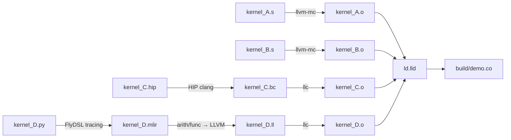

# ASM A 依次调用 ASM B、HIP C、FlyDSL D

本目录复制 `../asm_test01` 的示例和测试，增加 FlyDSL 编写的 D，目标为 **gfx1250 / wave32 / HSA code object v6**。A/B/C/D 分别生成原生二进制目标文件，再链接为 `build/demo.co`。

A 是可启动 kernel；B、C、D 是 A 内部调用的设备函数，在当前 wave 和 EXEC mask 下执行。A 在每个函数返回后继续执行，再调用下一个函数。

```cpp
uint32_t B(uint32_t a, uint32_t b) { return a + b; }        // ASM
uint32_t C(uint32_t value, uint32_t m) { return value*m+7; } // HIP __device__
uint32_t D(uint32_t value, uint32_t m) { return value*m+11; }// FlyDSL

__global__ void A(const uint32_t* a, const uint32_t* b, uint32_t* out) {
    uint32_t t = threadIdx.x;             // 一个 block，1..256 线程
    uint32_t sum = B(a[t], b[t]);
    uint32_t c = C(sum, 3);
    uint32_t d = D(c, 5);
    out[t] = d + 1;                     // 15*(a[t]+b[t])+47，模 2^32
}
```

## 文件

| 文件 | 作用 |
|---|---|
| `kernel_A.s` | ASM 入口，依次调用 B/C/D，最后加 1 并写回；提供 descriptor 和 metadata |
| `kernel_B.s` | 原样复制的 ASM 加法设备函数 |
| `kernel_C.hip` | 原样复制的 HIP 整数乘加设备函数 |
| `kernel_D.py` | FlyDSL `Uint32` 整数乘加函数 |
| `export_d.py` | 直接 tracing D 为 MLIR，再导出普通 CCC LLVM 函数 |
| `audit_c.py`、`audit_d.py` | 构建时检查编译出的函数接口、资源和空 metadata |
| `Makefile` | 四个独立原生对象的构建、链接和可选测试 |
| `test.cpp` | 更新后的 GPU 测试，比较 `15*(a+b)+47`，检查输入和输出 guard |
| `verify.py` | 扩展后的离线检查，覆盖三条调用重定位、独立函数字节及唯一 metadata |

## 构建流程



在本目录执行：

```bash
make objects     # 分别生成 A.o、B.o、C.o、D.o
make             # 链接为 build/demo.co
make inspect     # 导出 ELF 和反汇编
make host        # 只编译 host 测试程序
```

FlyDSL 默认使用仓库中已有的 `../mono_test20/build/venv/bin/python`，当前版本为 0.4.1。可以覆盖：

```bash
make PYTHON=/path/to/flydsl/python LLVM=/path/to/llvm/bin ROCM_PATH=/path/to/rocm
```

最终链接的输入是 **四个原生 ET_REL ELF**。C 的 bitcode 和 D 的 LLVM IR 都先经过后端编译；本例直接用 `ld.lld` 链接这些机器码对象。

## FlyDSL D 如何成为可调用函数

`kernel_D.py` 的实际源码：

```python
import flydsl.expr as fx

def kernel_D(value: fx.Uint32, multiplier: fx.Uint32) -> fx.Uint32:
    return value * multiplier + fx.Uint32(11)
```

`export_d.py` 复用 `callee_test21` 的直接 tracing 思路：创建两个 i32 参数的 `func.func`，用 FlyDSL 参数包装后调用上面的 Python 函数，记录产生的 `arith.muli`、`arith.addi` 和常量操作。随后运行 arith/func 到 LLVM 的 lowering，明确普通 CCC、noinline 和 protected visibility。

导出的 LLVM 函数形如：

```llvm
define protected i32 @kernel_D(i32 %value, i32 %multiplier) {
  %product = mul i32 %value, %multiplier
  %result = add i32 %product, 11
  ret i32 %result
}
```

构建调用 `llc --amdhsa-code-object-version=6`，确保 D 的对象格式与 A/B/C 一致。

D 不需要 HIP 包装，不启动 tracing kernel，不建立 JIT execution engine。D 以独立函数机器码保存在 D.o 中，返回指令完整保留；A 通过函数符号调用它。

## 调用接口

| 调用 | 输入 | 结果 | 返回 PC |
|---|---|---|---|
| A → ASM B | `v2=a[t]`、`v3=b[t]` | `v2` | `s[30:31]` |
| A → HIP C | `v0=B 的结果`、`v1=3` | `v0` | `s[30:31]` |
| A → FlyDSL D | `v0=C 的结果`、`v1=5` | `v0` | `s[30:31]` |

C 返回后，A 保留 `v0` 中的结果，准备第二个参数，再调用 D：

```asm
v_mov_b32 v1, 5
s_waitcnt_depctr 0
s_nop 7
s_getpc_b64 s[16:17]
s_add_nc_u64 s[16:17], s[16:17], kernel_D@rel64+4
s_swappc_b64 s[30:31], s[16:17]

// D 返回到这里。
v_add_nc_u32 v0, v0, 1
```

当前 LLVM 生成的 D：

```asm
kernel_D:
    s_wait_loadcnt_dscnt 0x0
    s_wait_kmcnt 0x0
    v_mad_u32 v0, v0, v1, 11
    s_set_pc_i64 s[30:31]
```

三个调用先后返回，不需要嵌套调用的返回地址栈。A 的输出指针和元素偏移继续保存在 `s[36:37]`、`v40`。A 的预算仍为 41 VGPR、38 SGPR 的逻辑使用上界，覆盖 C/D 各自的 2 VGPR、32 编号 SGPR，无 scratch/LDS；硬件分配按架构粒度取整。

## Metadata 和构建检查

LLVM 为 C/D 的纯设备函数对象各自输出一份空 kernel metadata。构建先确认函数接口、资源、没有外部引用、metadata 的 kernel 列表为空且没有 `.kd`，再用 `llvm-objcopy` 移除各自 `.note`。这不改变函数机器码。

最终由 A 提供唯一 kernel descriptor 和唯一 HSA kernel metadata。B/C/D 的调用直接跳转到代码符号地址，不读取单独的 kernel descriptor。

`audit_d.py` 与 `audit_c.py` 一样，是当前小表达式的严格构建约束：要求已审阅的四条原生指令、固定参数/返回寄存器及零 scratch/特殊资源。修改函数或升级编译器后，可能需要重新审阅这些约束。D 的 exporter 当前支持纯 i32 乘法、加法和常量。

## 测试和当前状态

显式执行测试：

```bash
make check          # 离线 ELF 检查，不运行 GPU
make run            # 在 gfx1250 上运行 host 测试
make run DEVICE=0   # 显式指定 HIP 设备编号
```

GPU 测试沿用 1、13、32、64、256 线程，以及普通数值、uint32 溢出、确定性伪随机输入。CPU 参考使用 64 位中间结果，最终转 uint32，检查 `15*(a+b)+47` 和输入/输出 guard。

离线测试扩展到三个调用：A.o 的三条 `R_AMDGPU_REL64` 按 B、C、D 顺序出现，链接后分别指向正确的函数地址；各函数字节与独立对象一致；C/D 的 note 移除不改变函数体；A 只有三处调用 literal 改变；最终无未解决重定位、只有 A.kd 和一份 metadata。

2026-11-13，本机 AMD LLVM 22 / ROCm 7.2.0 / FlyDSL 0.4.1 已完成分别编译、C/D 构建 ABI 检查、链接、ELF/反汇编导出和 host 程序编译。**没有执行 `make check`、`make run` 或 GPU 测试。**

当前地址和调用 literal：

```text
A = 0x1700，B = 0x1a00，C = 0x1c18，D = 0x1e00
B：0x174c + 0x2b4 = 0x1a00
C：0x1770 + 0x4a8 = 0x1c18
D：0x1790 + 0x670 = 0x1e00
```

详细产物在 `build/demo.elf.txt`、`build/demo.disasm.txt`、`build/kernel_D.mlir`、`build/kernel_D.ll`、`build/kernel_D.native.s`、`build/kernel_D.export.json` 和 `build/kernel_D.abi.json`。地址可能随链接布局改变，重定位会重新计算。
