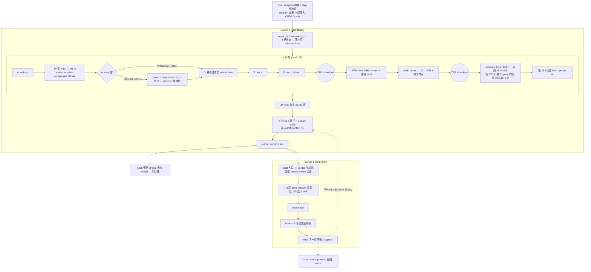

# DeepSeek V4.1 gfx1250 mono：kernel 流程与整网串联

> 基于 `/app/ATOM` 当前代码（HEAD `40c485c88`）与 `/data/models/DeepSeek-V4.1-Flash/config.json` 整理。
> 代码主体：`atom/models/deepseek_v41/mono/gfx1250/`。

## 0. 一句话

gfx1250 上的 V4.1 mono 不是“一层一个或几个 kernel”，而是**一个常驻的 FlyDSL kernel 跑完整个 decode step**（`kernels/step.py`）：

- **范围：** target 的 embedding、40 层 target、LM head、4 卡采样与投机 verify，以及 draft 的 context KV、3 层 draft、draft head 和 Markov 出草稿，全部在这一个 kernel 里。
- **启动方式：** 256 CTA × 256 线程（8 个 wave32）× 16-CTA cluster。
- **阶段同步：** 阶段之间不重新启动 kernel，而是用全局计数器做设备级 `handoff`。
- **TP4 通信：** 4 卡之间直接把数据推到对端的接收缓冲区，在 kernel 内部做 all-reduce 和采样交换。

实际部署时，同一份 kernel 代码按 `part` 编译成**两次启动**（同一个 stream）：

| 启动 | `part` | 内容 |
|---|---|---|
| launch 0 | `target` | target 入口 → 40 层 target → head → 采样 + verify（其间穿插 draft 的 context KV） |
| launch 1 | `draft` | draft 入口（由 verdict 生成元数据）→ 3 层 draft → draft head → Markov 出下一步草稿 |

拆成两次启动，是为了 launch 0 一结束 host 就能在旁路 stream 上拷出 verdict，与 launch 1 并行。

与 gfx950 的区别：gfx950 走 `MonoDecodeModel`（每层 K1/K2a/K2b 几个 kernel）或 `hi_*` 路径；gfx1250 由 `mono/dispatch.py::install_mono_decode` 判断 `gfx1250.enabled()` 后，直接装上 `install_single_step`。

---

## 1. 启用条件

**部署级**（`gfx1250/config.py::config_refusal`，任何一条不满足就整体关闭，所有 step 都走 production 路径）：

- `ATOM_MONO_ENABLE=1`（默认），设备是 gfx1250；
- TP = 4；
- 投机方法为 DSpark，block = 5（每个请求 verify 6 行：anchor 加 5 个草稿）；
- 不用 confidence schedule，也不用 ragged verify；
- KV cache 为 BF16，index cache 为 FP8；
- 最多 8 个请求，即 48 行 target、40 行 draft。

**每个 step**（`dispatch.py::SingleStepModel.single_step_runner`），不满足就退回 production 路径：

- 是 decode 步，有 `spec_decode_metadata`，行数为 `bs × 6` 且不超过 48；
- 没有 structured output、logprobs 和 required channel（kernel 只输出 token id 和 verdict，不输出 logits）；
- 通过 `runner.precheck`（请求形状在 kernel 支持范围内）。

prefill、eager 的 decode、以及上面不满足的 step，都走 ATOM 原有的 forward + sampler + DSpark proposer。`ATOM_MONO_CHECK=1` 时由 production 路径出结果，mono 只在旁边跑一遍做对比。

---

## 2. 网络结构（V4.1-Flash 实际配置）

`hidden 5120`、`q_lora 1280`、`head_dim 512`、64 头（TP4 每卡 16 头）、mHC `hc_mult 4`；MoE 为 384 个路由专家取 top-6 加 1 个共享专家，`moe_inter 2304`（每卡 576，存储补齐到 640）；词表 129280（每卡 32320）。indexer 32 头 × 128，top-512；滑动窗口 128。

由 `compress_ratios`、`kv_source_layer_ids [2,8,14,20]`、`index_source_layer_ids [2,8,14,20,24,28,32,36]`、`candidate_source_layer_id 20`、`engram_layer_ids [1,14]`、`dspark_target_layer_ids [37,38,39]` 推出每层的类型：

| 层 | 压缩比 | 注意力模式 | kernel 里多做的事 |
|---|---|---|---|
| 0、1 | 0 | WINDOW | 只看窗口 key；第 0 行带 Engram（为第 1 层准备） |
| 2、8、14 | 2 | FULL（kv 和 topk 的 owner） | indexer（iq/iw/iquant）+ compressor（cgemm/crow/cring）+ 打分 + 两轮 top-512 选择；第 13 行带 Engram（为第 14 层准备） |
| 3–7、9–13、15–19 | 2 | REUSE | 直接读 owner（2/8/14）选出的行加窗口 |
| 20 | 1 | FULL + 产出候选块 | indexer + compressor + 打分，同时写 8 行一块的块最大值；两轮 top-512 加两轮 top-2048 候选块，共 4 轮选择 |
| 24、28、32、36 | 1 | REINDEX | indexer（不含 compressor），只对第 20 层的候选块打分；两轮选择 |
| 21–23、25–27、29–31、33–35、37–39 | 1 | REUSE | 读最近的 topk owner 的选择结果 |
| 36、37、38 结束时 | — | — | draft context tap：取第 37/38/39 层的输入残差，即 `dspark_target_layer_ids` |
| draft 第 0–2 层（第 40–42 行） | 0 | WINDOW | 路由改为 128 个专家取 top-3，没有 indexer、Engram 和 tap |

层表 `fp` 中各行：第 0–39 行是 target 层，第 40–42 行是 draft 层，第 43 行是 draft 入口，第 44 行是 target 入口。每一行的 `lflags` 位：

- bit1：有 compressor；bit2：压缩比 1；
- bit3：indexer 层；bit5：产出候选块；bit6：REINDEX；
- bit4：context tap；bit7：下一层有 Engram。

---

## 3. Host 侧：一次 decode step 怎么调到 kernel

```text
ModelRunner.run_model
  └─ self._step_override(input_ids, running_bs, batch)          # model_runner.py:3406
       └─ SingleStepModel.step_override                          # gfx1250/dispatch.py
            ├─ single_step_runner(): 判断能否服务（第 1 节）
            └─ SingleStepRunner.run_step → launch                # gfx1250/runner.py
                 ├─ _sampling(batch)         每行的温度、top-p、seed、greedy，以及上一步保留的 q → sparam
                 ├─ _host_inputs()           host 侧检查，少量几何信息的 H2D 刷新，graph key
                 ├─ first()  ← 按宽度录成 CUDA Graph 并重放
                 │    ├─ Engram 阶段（查表 + 旁路 stream 上的 all-gather，在启动前 join）
                 │    ├─ _device_inputs()    write_step_meta / write_draft_step_meta：
                 │    │                      kmeta / ksel / knsel / kvw / rpos / RoPE / tids / btab / ibat / cplan …
                 │    └─ launches[0]         part="target"
                 ├─ _ev_verify.record()
                 └─ launches[1]              part="draft"
ModelRunner 后处理
  ├─ runner.verify_outputs(bs)   在旁路 stream 上拷出 outtok [bs,6] 和 verdict [3,bs]，代替 rejection sampler
  └─ drafter.propose（已包装）  → runner.draft_ids(bs)，即 mids [bs,5]；compute_draft_kv 直接跳过
```

**构造时**（`SingleStepRunner.__init__`，TP 组集体执行）：

- **内存：** 按最宽的 step 分配 scratch（`buffers.scratch_bytes`）。4 卡的对称接收缓冲区用 `SymmetricPeerBuffer`（fine-grained、按奇偶双缓冲）。
- **指针表：** `StepTables` 生成三张表：
  - `fptab`：FPTRS + ATAB + 每层一行 LKEYS；
  - `tp`：尾部用；
  - `ctxtab`：draft context KV 用。
- **预编译：** 6、12、…、48 行这 8 个宽度，每个宽度编译 target 和 draft 两次启动，每个宽度编译后做一次 TP barrier，避免运行中途遇到新宽度时 JIT 卡住。

kernel 参数只有 9 个：`recv0..3`、`cnt`（每步清零的 handoff 计数器）、`st`（时间戳）、`scale`（softmax scale）、`fp`、`tp`。其他所有指针都放在设备端表里，用标量 load 读取。原因是参数一多，SGPR 会 spill 到 scratch。

---

## 4. 设备侧公共机制

| 机制 | 说明 | 代码 |
|---|---|---|
| handoff | 每个 CTA 执行 `s_wait_storecnt 0` 后对计数器加 1，后续阶段等计数达到 256。交换数据用 device scope 的 relaxed store，不需要 fence | `device.handoff / wait_count / stx_dev` |
| 计数器布局 | 每层 256 B：ATTN_A、INDEX_QUANT、KV_C、SCORE、SELECT×n、ATTN_D、ATTN_E、TP1/TP2 列组、FRONT、MOE_UG、MOE_DONE、LAYER_END …；最后是尾部计数器（HEAD、SAMPLE、VERIFY_DONE、MARKOV、DRAFT_STATE …） | `kernels/layout.py` |
| 列组等待 | front 的 CTA (g,p) 只读 y 的第 320p 起的 320 列，所以只等负责这些列的 16 个 TP CTA（`gpub`/`gwait`），不等全设备 | `step.py` |
| TP all-reduce | 每个 CTA 把自己 20 列 × TR 行的 fp32 转成 bf16，每 16 B 打包 3 对数据加 1 个 tag，nontemporal 推给 3 个对端；轮询对端数据后按 rank 顺序求和，得到 y（`tp_allreduce`）。每层两次：TP1 在 wo_b 之后，TP2 在 MoE combine 之后 | `attention.py` |
| step epoch | 接收缓冲区按 `tpep & 1` 分成两半；每步开始时本 rank 清零另一半，留给下一步；结束时 CTA 0 把 epoch 加 1 | `tp_epoch_begin/end` |
| 超时 | 跨卡轮询最多等 2 s，超时计数写入 `cyc`，host 晚一步读出并报 error | `note_timeout`、`_check_timeouts` |
| 指令预取 | 一层的代码比指令缓存大，所以在 front 和 MoE 之前各发一次 `s_prefetch_inst_pc_rel` | `iprefetch` |

LDS 固定分区：

- `[0, 4096)`：TP 归约的 payload；
- `FRONT_LDS` 起：front 和 MoE 的工作区；
- `RKEEP = 294912` 起：两个 front 之间保留的 4 路残差流 R，因此层间残差不经过全局内存。

---

## 5. launch 0（`part="target"`）

### 5.1 target 入口

1. **`draft_ctx.stage_block_state(W=1)`：** 对 `tids` 取 embedding，得到 R = 4 份 embedding 拷贝，`pre=(1,0,0,0)`，`y=0`，`post=0`，`comb=I`；然后 handoff `TARGET_STATE`。
2. **`entry_front`（96 个 front CTA）：** 用第 44 行的 a* 权重做第 0 层的 attention front，输出 `x8`/`xs`（MXFP8）、门控和 Sinkhorn 的 comb，R 留在 LDS；然后 handoff `TARGET_FRONT`。

### 5.2 每层 target（Ly = 0..39）

下文的代码位置都相对于 `atom/models/deepseek_v41/mono/gfx1250/`，格式为 `文件:行号`。

#### 5.2.0 循环结构与“一层”的边界

- **运行时循环，一份代码：** `for Ly in range(seg_lo, seg_hi)`（`kernels/step.py:267`）是普通 `range`，FlyDSL 把它改写成运行时 `scf.for`，层代码只生成一份，执行 40 遍。外层按段遍历用的 `range_constexpr`（`step.py:220`）才在编译期展开。一层的代码比指令缓存还大，展开 40 份会让取指严重变慢。
- **每层的参数：** 迭代开头用 `ltab(fp, Ly, name)`（`step.py:166`）从层表第 Ly 行读本层的权重指针，计数器基址是 `lc = cnt + Ly * LCB`（`step.py:274`）。
- **层与层的差别：** 全部是读本行 `lflags` 后的运行时分支。各位的含义见 `step.py:318` 的注释：

  | bit | 含义 |
  |---|---|
  | 1 | 有 compressor |
  | 2 | compressor ratio = 1 |
  | 3 | indexer 层（FULL / REINDEX） |
  | 4 | draft context tap |
  | 5 | 生成候选块（第 20 层） |
  | 6 | REINDEX |
  | 7 | 下一层有 Engram |

**一次迭代与模型的“一层”并不完全对齐：**

1. **第 Ly 层的 attention front 在上一次迭代末尾做。** 每次迭代 `hf=1` 那一遍生成的是第 Ly+1 层的 `x8`/`xs`/`axn` 和 mHC 系数。
   - 第 0 层的 attention front 在循环外的 `entry_front` 里做（见 5.1）。
   - 第 39 层的 `hf=1` 做最后一次 mHC 收拢，结果写到 `xh`，作为 LM head 的输入（`step.py:399`）。
2. **Engram 的准备工作放在前一行做。** 第 0、13 行执行 `stage_engq`/`stage_engkv`，门控在同一次迭代的 attention front 里完成，效果上属于第 1、14 层。
3. **tap 不属于 transformer 层的计算。** 它只为 draft 的 context KV 取残差。

因此，模型第 Ly 层的完整计算是：上一次迭代的 attention front → A → kv → C →（indexer / compressor）→ D → E → F → TP1 → FFN front → MoE → combine → TP2。

#### 5.2.1 一次迭代的执行顺序

```text
[bit7]  stage_engq                                                   step.py:304
A       stage_A ; 预取 wq_b                                          step.py:307-309   ─ ATTN_A
[bit7]  stage_engkv                                                  step.py:311
kv      stage_kv                                                     step.py:315
C       stage_C                                                      step.py:316
[bit3]  stage_iq / stage_iw ;[bit1] stage_cgemm                      step.py:317-328   ─ KV_C
[bit3]  stage_iquant ;[bit1] stage_crow / stage_cring                step.py:330-345   ─ INDEX_QUANT
[bit3]  stage_score_any（ibat ≠ 0 才执行）                             step.py:346-360   ─ SCORE
[bit3]  stage_select_any × npass                                     step.py:361-366   ─ SELECT0 + 4·pass
D       stage_D ; 预取 wo_a                                          step.py:367-368   ─ ATTN_D
E       stage_E ; 预取 wo_b                                          step.py:370-371   ─ ATTN_E
F       stage_F_cluster                                              step.py:373
TP1     tp_allreduce → y1 ; gpub                                     step.py:375-377   ─ TP1_GROUPS（列组计数）
for hf in 0, 1（同一份代码）                                           step.py:379
  hf=0  gwait(TP1) → FFN front（front_any, isffn）                   step.py:384-422
        [宽 batch] 闲置 CTA 提前做共享专家 UG（ug_shared_early）        step.py:423-434   ─ FRONT
        moe（union → UG → DN）                                        step.py:438-443   ─ MOE_UG（moe 内部）
                                                                     step.py:445       ─ MOE_DONE
        moe_combine → tp_allreduce → y2 ; gpub                       step.py:447-450   ─ TP2_GROUPS
  hf=1  gwait(TP2) → 下一层的 attention front（front_any）             step.py:384-422
                                                                     step.py:451       ─ LAYER_END
[bit4]  stage_tap1                                                   step.py:452-456
```

#### 5.2.2 attention 主干：A → kv → C → D → E → F → TP1

**A：`stage_A`**（`kernels/attention.py:180`）

- **输入：** 上一个 attention front 输出的 `x8`/`xs`，即归一化后的 x，MXFP8 格式。
- **GEMM `x · wqkv_aᵀ`**（`attention.py:181-211`）：
  - N = 1280（q latent）+ 512（kv）= 1792 列，分成 112 个 16 列 tile；
  - CTA 0..223 每两个 CTA 负责一个 tile，K = 5120 分成两半，各算一半；
  - 用 MXFP8 WMMA 计算，CTA 内各 wave 的部分和先在 LDS 里相加，再写到 `qkv_part[kh]`。
- **收尾**（`attention.py:212-250`）：`cluster_sync` 之后，56 个 CTA（`b % 4 == 0`，每个 32 列）执行：
  1. 两半 K 相加，舍入到 bf16，写 `qkv`。q latent 和 kv 都存成 bf16，**kv 在这里不量化**；
  2. 逐行累加平方和，q 部分写到 `ss[0..T)`，kv 部分写到 `ss[T..2T)`，供后面算 rstd；
  3. **q_norm 的前一半：** q latent 乘 `qnw`（q_norm 权重），每 32 个元素一组求 amax，量化成 MXFP8，写 `qr8`/`qrs`。这里还没有乘 rstd：rstd 要等整行平方和在 `ATTN_A` 之后到齐才能算，所以放到 C 的 GEMM 之后再乘。RMSNorm 的 rstd 是逐行标量，可以挪到 GEMM 后面。
- **预取：** `wq_b` 中本 CTA 要读的两组行（`step.py:308-309`）。

**kv：`stage_kv`**（`attention.py:255`）

CTA 0..11 参与，每个 CTA 处理 4 行：

1. **kv_norm：** `rsqrt(ss[T+r] / 512 + eps) × kvnw`，结果为 bf16，写 `kvn`；
2. **RoPE：** 只作用于最后 64 维（448..511），相邻两维成一对旋转，位置取自 `rpos[r]`；
3. **QAT：** 每 32 个元素一组取 E8M0 scale，量化成 e4m3 再反量化回 bf16，与 production 的 `rope_window._quantized_row` 逐位一致；
4. **写回：** 写入本层窗口 ring 行，即 KV cache：`kv[(kvw[r] + kring_off) × 512]`。`kvw[r] = -1` 表示 pad 行，跳过不写。

**C：`stage_C`**（`attention.py:300`）

- **GEMM `q = qr8 · wq_bᵀ`：** K = 1280，N = 16 头 × 512 = 8192。每个 CTA 算 `b` 和 `b+256` 两个 16 列 tile，用 MXFP8 WMMA。
- **q_norm 的后一半：** 结果乘 `rsqrt(ss[r] / 1280 + eps)`。
- **RoPE：** 每个头的最后 64 维，结果为 bf16，写 `q`。
- kv、C 以及 5.2.3 中的 iq/iw/cgemm 都属于同一个阶段，统一在 `KV_C`（`step.py:329`）同步。

**D：`stage_D`**（`attention.py:359`），稀疏注意力

- **分工：** 每个 16-CTA cluster 负责 RPC 行（TR ≤ 32 时 RPC = 2，否则为 3）。cluster 内第 jj 个 CTA 负责每行 640 个 key 中的 40 个。
- **key 列表**（`_kg_rows`，`attention.py:335`）：
  - 前 `n_sel`（≤ 512）个 key 是 indexer 选出的 pool 行（`ksel`）；
  - 其后是窗口 ring 行，从最老的开始排；
  - 超过 `kv_len` 的 key 会被 mask 掉；
  - WINDOW 层 `n_sel = 0`，只有窗口部分。
- **计算：**
  1. K 行和 q 异步拷到 LDS；
  2. `S = q·Kᵀ × scale`，用 bf16 WMMA；
  3. 本 CTA 内做 softmax，求局部的 `m` 和 `l`；
  4. 计算 `P·V`，这里 V 就是 K 本身（K、V 共用同一份 KV）；部分结果写 `apart`，`m`/`l` 写 `aml`。
- **合并：** `cluster_sync` 之后合并 16 个 CTA 的部分结果。**attention sink** 作为额外一项参与求 max 和分母（`attention.py:494-506`）。
- **反向 RoPE：** 输出的最后 64 维旋转 −θ（`attention.py:518-533`）。
- **输出：** 每 32 个元素一组量化成 MXFP8，写 `o8`/`os`。
- **预取：** `wo_a`（`step.py:368`）。

**E：`stage_E`**（`attention.py:556`），`wo_a`

- **分组低秩投影：** 16 个头分成 2 组，每组 8 头 × 512 = 4096 维，投影到 1024 维，两组合计输出 2048 维。
- **分工：** 每 4 个 CTA 负责 32 列，K = 4096 切成 4 份（每份 1024），`cluster_sync` 之后 4 份相加，舍入到 bf16。
- **输出：** 每 32 个元素一组量化成 MXFP8，写 `y8`/`ys`。
- **预取：** `wo_b`（`step.py:371`）。

**F：`stage_F_cluster`**（`attention.py:612`），`wo_b`

- **投影：** 2048 → 5120。分成 64 个列组，每组 80 列；每组 4 个 CTA 各算 K 的 1/4（512），`cluster_sync` 之后相加。
- **输出：** 本卡的 fp32 部分和写到 `out`，同时留在 LDS `[r][20]`（每个 CTA 20 列），供 TP 使用。

**TP1：`tp_allreduce`**（`attention.py:653`，调用处 `step.py:375-377`）

1. **推送：** 每个 CTA 把 20 列 × TR 行转成 bf16，每 16 B 装 3 对数据和 1 个 tag（tag = `2·Ly+1`），用 nontemporal store 推给 3 个对端。接收区按 `Ly % 2` 交替使用。
2. **归约：** 轮询直到 3 个对端的 tag 都到齐，按 rank 顺序求和，用 device scope store 写 `y1`。
3. **计数：** `gpub`（`step.py:148`）给自己所在列组的 `TP1_GROUPS` 计数加 1。

#### 5.2.3 indexer / compressor（`lflags` bit3 的层；bit1 的层另有 compressor）

compressor 只出现在第 2、8、14 层（ratio 2）和第 20 层（ratio 1）。

| 顺序 | 函数 | 调用处 | 计算 |
|---|---|---|---|
| 1 | `stage_iq`（`kernels/index_query.py:46`） | `step.py:322` | indexer 的 wq_b [4096][1280]（FP8）× `qr8`，乘 q 的 rstd，转 bf16；32 个 128 维头各自对 64..127 维做 GPT-J 式 RoPE，写 `iq` |
| 2 | `stage_iw`（`index_query.py:79`） | `step.py:323` | weights_proj [32][5120]（bf16）× `axn`（attention front 输出的 bf16 归一化行），按 K 切片得到 fp32 部分和 `iwp` |
| 3 | `stage_cgemm`（`kernels/compressor.py:50`，bit1） | `step.py:327-328` | compressor 的 wkv_gate × `axn`，得到部分和 `cpart`（ratio 2 时 1024 列 = values \| scores；ratio 1 时 512 列） |
| | handoff `KV_C` | `step.py:329` | |
| 4 | `stage_iquant`（`index_query.py:100`） | `step.py:332` | 各切片相加得到 iw（bf16）；每个 (token, head) 的 128 维 iq 按 amax 量化成 e4m3，写 `iq_out`/`iqs_out`；`iw_out = w·scale/64` |
| 5 | `stage_crow`（`compressor.py:116`，bit1） | `step.py:343` | 对每个压缩计划行生成压缩后的 main KV 行和 index 行，步骤见表下说明 |
| 6 | `stage_cring`（`compressor.py:241`，bit1） | `step.py:344` | 本步的原始投影写入 7 槽 ring（slot = pos % 7）：kv 为 fp32，score 为 fp32 + `ape[pos % ratio]`，供之后的位置做压缩 |
| | handoff `INDEX_QUANT` | `step.py:345` | |
| 7 | `stage_score_any`（`kernels/index_score.py:53`） | `step.py:359` | 对上下文超过 512 的行打分，规则见表下说明。`ibat = 0` 的层跳过 |
| | handoff `SCORE` | `step.py:360` | |
| 8 | `stage_select_any`（`kernels/topk.py:258`）× npass | `step.py:361-366` | 两级选择树上的精确 top-k，各类层的轮数见表下说明。每轮之后 handoff `SELECT0 + 4·pass` |

`stage_crow` 对每个压缩计划行依次执行：

1. ratio 2 时，对 2 个来源（上一个位置从 ring 读，或当前输入行）逐通道做 online softmax 加权；ratio 1 时直接取值；
2. RMSNorm，得到 bf16 的 latent；
3. 对 448..511 维做 RoPE，得到压缩后的 main KV 行；
4. 计算 `keys = latent · wkᵀ`（128 维），做 k_norm，对 64..127 维做 RoPE，量化成 scale 为 2 的幂的 FP8，写入 index plane 的 8 行块。

`stage_score_any` 的打分：用 FP8 WMMA 算 `q·key`，再对 32 个头求和 `relu(acc × kscale) × w[head]`，写 `ilog[r][col]`。

- FULL 层扫描所有可见的 index 行；
- REINDEX 层（bit6）只扫描第 20 层留下的候选块对应的列；
- 第 20 层（bit5）另外写出每个 8 行块的最大值 `ibmax`。

`stage_select_any` 各类层的轮数：

- **FULL：** 2 轮 top-512，结果写 `isel`/`irow`，即 D 用的选中行；
- **REINDEX：** 2 轮，在候选列里选 top-512，再映射回真实行；
- **第 20 层：** 先做 2 轮 top-512，再做 2 轮，从块最大值中选 top-2048 个块，写 `icand`，供后面的 REINDEX 层使用。

#### 5.2.4 Engram（`lflags` bit7，第 0、13 行）

| 函数 | 调用处 | 时机 | 计算 |
|---|---|---|---|
| `stage_engq`（`kernels/engram.py:41`） | `step.py:304-306` | A 之前 | 把本步的 Engram embedding `engemb` [T][6144]（bf16）量化成 MXFP8，写 `eng8`/`engs` |
| `stage_engkv`（`engram.py:71`） | `step.py:311-314` | `ATTN_A` 之后，与 kv/C 同一阶段 | `engkv = eng8 · engwᵀ`，结果为 bf16。engw [25600][6144] 是 e4m3，前 4 段各 5120 行是 4 个分支的 key，最后 5120 行是共享 value |
| `_engram_gate`（`kernels/front.py:112`） | `front_A` 内（`front.py:186`） | 本次迭代 `hf=1` 的 attention front | 门控：`R' += gate · value` |

#### 5.2.5 两个 front、MoE 与 TP2（`step.py:379-450`）

两个 front 共用同一段代码，`for hf in range(opaque(2))` 循环两次：

- **参与范围：** 只有前 96 个 CTA 执行 front（6 组 × 16 个位置，每个 CTA 负责 8 个 token × 320 列）。
- **等待：** 每个 front CTA 只等负责自己 320 列的 16 个 TP CTA，即 `gwait`（`step.py:157`）。hf=0 等 `TP1_GROUPS`，hf=1 等 `TP2_GROUPS`。
- **区分两个 front：** 用 `fsel`/`lsel` 在运行时挑选指针。例如 FFN front 用 `fnh`/`nw`/`R`/`y1`，attention front 用 `afnh`/`anw`/`Rout`/`y2`。

**`front_any`**（`kernels/front.py:506`）的子步骤：

| 子步骤 | 代码 | FFN front（hf=0） | attention front（hf=1） |
|---|---|---|---|
| A | `front_A`（`front.py:158`） | mHC post + pre，计算方式见表下说明 | 同左；下一层是 Engram 层时额外做门控 |
| B | `front_B`（`front.py:240`） | 用 R' 乘 fn 的 hi/lo 两部分，得到 mHC 动态系数（mixes）的部分和（bf16 WMMA） | 同左 |
| | cluster 屏障 1 | | |
| C | `front_C`（`front.py:283`） | `x1` 做 RMSNorm × `nw`，得到 MXFP8 的 `fx8`/`fxs`，作为 MoE 输入 | 同左，输出 `x8`/`xs`（给下一层 A）和 bf16 `axn`（给 indexer 和 compressor）；第 39 层改写到 `xh` |
| D | `front_D`（`front.py:333`） | 路由 logits 的部分和（本 CTA 负责的 320 列 gate） | 不执行 |
| | cluster 屏障 2 | | |
| E1 | `front_E1`（`front.py:356`） | 每个 CTA 负责 24 个专家：16 份 logits 相加，sqrtsoftplus 打分；选专家时加 `gbias`（`front.py:370`），在本地取 top-6 | 不执行 |
| | cluster 屏障 3 | | |
| E2 | `front_E2`（`front.py:398`） | p=0 的 CTA 合并 16 × 6 个候选，得到 `ids`/`wts`（权重重新归一后 × 1.5，`front.py:455`）；p=1 的 CTA 计算下一子层的 mHC 系数，计算方式见表下说明 | 只做 p=1 的那部分 |

`front_A` 的计算：

- `R'_j = bf16(post_j·y + Σ_h comb[h][j]·R_h)`，即把子层输出 y 并回 4 路残差；
- `x1 = bf16(Σ_j pre_j·R'_j)`，同时求平方和；
- 残差平时保留在 LDS（`RKEEP`）里；第一层从全局读入，最后一层和 tap 层的输入写回全局 `Rout`（`front.py:216`）。

`front_E2` 中 p=1 的 CTA 计算下一子层的 mHC 系数：

- `npre = sigmoid(·) + eps`（`front.py:480`）；
- `npost = 2·sigmoid(·)`（`front.py:481`）；
- `ncomb` 经 Sinkhorn 归一（`front.py:502`）。

**hf=0 之后的 MoE 部分：**

| 步骤 | 代码 | 调用处 | 计算 |
|---|---|---|---|
| 共享专家提前 UG（只在宽 batch 时） | `ug_shared_early`（`kernels/moe.py:559`） | `step.py:423-434` | front 闲置的 CTA 等 `X8_PUB`（`step.py:415`）后，先算 FP8 共享专家 UG 的 K 切片 |
| handoff `FRONT` | | `step.py:437` | 之前在 `step.py:436` 预取 16 KB 的 MoE 指令 |
| 专家并集 | `moe_union`（`moe.py:238`） | `moe()`（`moe.py:813`）内 | 每个 CTA 都构建本步的专家并集和每个专家的 pick 列表，用排序网络保证所有 CTA 得到相同的顺序；共享专家作为 `ceil(rows/16)` 个伪专家排在最后 |
| UG | `moe_ug`（`moe.py:421`） | 同上 | 一个工作单元 = (专家, 32 列组)，K = 5120。路由专家做 FP4 × MXFP8 WMMA，共享专家做 FP8 × MXFP8 并放在末尾的专用 CTA 上；然后 SwiGLU（clamp 10）、转 bf16、量化成 MXFP8，写 `MID` |
| handoff `MOE_UG` | | `moe.py` 内 | |
| DN | `moe_dn_stage`（`moe.py:660`）→ `moe_dn`（`moe.py:694`）→ `moe_dn_shared`（`moe.py:773`） | 同上 | 每个 CTA 把自己负责的 ≤ 3 个专家的 MID 读进 LDS，算 down 投影并乘路由权重，写每个 (行, pick) 的 fp32 部分和；共享专家的 down 放在专用 CTA 上做，或在路由 down 之后由全部 CTA 做 |
| handoff `MOE_DONE` | | `step.py:445` | |
| combine | `moe_combine`（`moe.py:386`） | `step.py:447` | 每行把 6 个 pick 相加，再加共享专家的输出，写到 LDS `[r][20]` |
| TP2 | `tp_allreduce`（tag = `2·Ly+2`）+ `gpub` | `step.py:449-450` | 结果写 `y2`，作为 hf=1 attention front 的 y |

#### 5.2.6 迭代结尾

- **handoff `LAYER_END`**（`step.py:451`）。
- **tap**（`lflags` bit4，第 36/37/38 行）：`stage_tap1`（`kernels/draft_ctx.py:213`，调用处 `step.py:452-456`）。它取刚由 attention front 写出的 `aRout`，即第 37/38/39 层的输入残差，求 4 路均值后量化成 MXFP8，写 `aux8`/`auxs`，供 5.3 中 draft context KV 的 `main_proj` 使用。

#### 5.2.7 CTA 分工与同步点

各阶段的 CTA 分工：

| 阶段 | 参与的 CTA |
|---|---|
| A | GEMM 用 CTA 0..223，收尾用 56 个 CTA |
| kv | CTA 0..11 |
| C、E、F、MoE | 全部 256 个 |
| D | `ceil(TR/RPC)` 个 16-CTA cluster |
| front | 前 96 个 CTA，每个负责 8 个 token × 320 列，正好覆盖 48 行 × 5120 |
| 采样（5.3） | 每行 5 个 CTA，共 240 个 |

同步点数量：

- **普通 WINDOW/REUSE 层有 10 个：** ATTN_A、KV_C、ATTN_D、ATTN_E、TP1 列组、FRONT、MOE_UG、MOE_DONE、TP2 列组、LAYER_END。
- **FULL 和 REINDEX 层多 4 个：** INDEX_QUANT、SCORE 和 2 个 SELECT。
- **第 20 层多 6 个：** 它有 4 轮选择。
- **宽 batch 时多一个 `X8_PUB` 计数：** 只有提前做共享专家 UG 的闲置 CTA 会等它。

### 5.3 target 尾部（`tail.target`）

1. **`head.head_once_r`：** 每卡 vocab 分片的 LM head，`logits[48][32320] = xh · W^T`，不做 all-gather；然后 handoff `HEAD_DONE`。
2. **`sample.sample_once_p`：** 4 卡联合的 top-p 采样，融合了 DSpark 的 PROB_DRAFT 和 BLOCK_VERIFY 校验：
   - 共 P0–P5 几轮，每轮先在本卡内 handoff，再与 3 个对端交换带 tag 的记录，按 rank 顺序合并，所以每卡得到逐位相同的结果；
   - T > 0 的行做 p/q 校验和残差 Gumbel-max；greedy 的行做 argmax 匹配；
   - 最后由 CTA 0 写出 `outtok [8][6]`、`verdict [3][8]`（接受数、拒绝数、anchor 行）和 `anc [8]`；
   - **draft 的 context KV**（`draft_ctx.ctx_parts`）插在采样各轮的交换间隙里执行：
     1. `main_proj`（输入是第 37–39 层 tap 出的 aux8）；
     2. `main_norm`；
     3. 3 层 draft 的 `wkv`；
     4. kv norm、RoPE 和 QAT，写入各 draft 层的窗口 ring。
3. handoff `VERIFY_DONE`。launch 0 到此结束；host 在 `_ev_verify` 之后拷出 verdict。

---

## 6. launch 1（`part="draft"`）

1. **draft 入口：**
   - `draft_meta`（CTA 0）根据 verdict 算出每个请求的 anchor 行和位置，写入 `kmeta_d / kvw_d / rpos_d`；
   - `stage_block_state(W=5)` 构造每个 draft 行（请求 × 5 个 block 位置）的 4 路状态：位置 0 是 anchor 的 embedding，其余位置是 noise token（128799）；然后 handoff `DRAFT_STATE`；
   - `entry_front` 用第 43 行，即 draft 第 0 层的 a* 权重；然后 handoff `DRAFT_FRONT`。
2. **3 层 draft（第 40–42 行）：** 与 target 层同一份层代码，按 TRD = 5 × 请求数的行宽编译。只有窗口注意力，路由改为 128 选 3，没有 indexer、Engram 和 tap。最后一层的 attention front 写出 `dh`（draft head 的输入）。
3. **draft 尾部（`tail.draft`）：**
   - `head_once_r(dh)` 复用同一份 head 权重，输出 `dlog`；然后 handoff `DRAFT_HEAD_DONE`；
   - `markov.markov_once`：对 5 个 block 位置依次计算 `logits_k = base_k + W1[x_{k-1}] @ W2^T`（rank 256，W2 按 vocab 分片），4 卡交换各自的最大值，T > 0 用 Gumbel-max，greedy 用 argmax；
   - 输出 `mids [8][5]`（下一步的草稿），以及 `qlog / qids`（留给下一步 verify 用的 q）。
4. `tp_epoch_end`：epoch 加 1。

---

## 7. 整网串联：一个 decode step 的完整数据流



**跨 step 保留的状态：**

- 各层的 KV cache：窗口 ring 行，以及 compressor 写入的压缩 KV、index plane 和 ring 状态；
- draft 各层的 context KV ring；
- `qlog / qids`：本步草稿的 q，下一步 verify 时读取；
- `mids`：作为下一步 verify 的输入 token；
- `tpep`：接收缓冲区的 epoch。

层间流转的每一层都是：

1. **attention body：** 输入 x8 来自上一层末尾的 attention front；
2. **TP1：** 把 attention 输出归约得到 y1；
3. **FFN front：** 输入是 R 加 y1；
4. **MoE；**
5. **TP2：** 把 MoE 输出归约得到 y2；
6. **attention front：** 输入是 R 加 y2，输出下一层的 x8。

4 路 mHC 残差 R 在整层期间一直留在 LDS，只在 tap 层和最后一层写回全局内存。

---

## 8. 代码索引

| 内容 | 文件 |
|---|---|
| 启用判断与部署限制 | `mono/dispatch.py::install_mono_decode`，`gfx1250/__init__.py`，`gfx1250/config.py` |
| 每步路由与包装 drafter | `gfx1250/dispatch.py::SingleStepModel` |
| 构造、编译、启动、输出 | `gfx1250/runner.py::SingleStepRunner` |
| 每步输入与 sampling 参数 | `gfx1250/inputs.py`，`mono/step_meta.py` |
| 指针表与层行（`lflags`） | `gfx1250/tables.py`，`gfx1250/buffers.py` |
| 顶层 kernel | `gfx1250/kernels/step.py::build` |
| 维度和计数器、LDS 布局 | `kernels/dims.py`，`kernels/layout.py` |
| attention A/kv/C/D/E/F、TP all-reduce | `kernels/attention.py` |
| indexer | `kernels/index_query.py`，`index_score.py`，`topk.py`，`index_plan.py` |
| compressor | `kernels/compressor.py` |
| Engram | `kernels/engram.py`（门控在 `front._engram_gate`） |
| mHC front、路由、Sinkhorn | `kernels/front.py` |
| MoE | `kernels/moe.py`，`moe_plan.py` |
| head、采样、verify | `kernels/head.py`，`sample_common.py`，`sample.py`，`tail.py` |
| draft 的 context KV 与入口 | `kernels/draft_ctx.py` |
| Markov 出草稿 | `kernels/markov.py` |
| 调试与时间线 | `gfx1250/debug.py`（`ATOM_MONO_CHECK`、`ATOM_MONO_TIMELINE`） |
