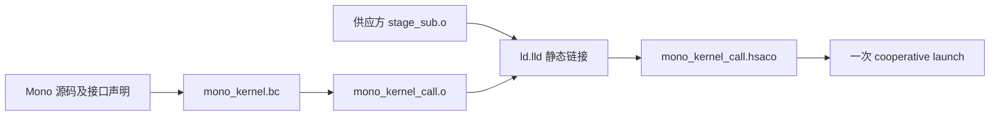
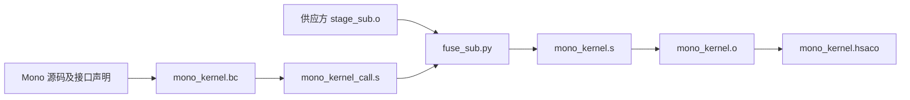

# Mono kernel 二进制阶段接入与跨阶段状态管理

记录日期：2026-11-09。

本文统一记录两个层面的方法及其真机实验：

| 层面 | 方法 | 解决的问题 |
| --- | --- | --- |
| 二进制接入与控制流 | 设备函数静态链接 | 用声明和机器码目标接入阶段，保留设备函数 call/return |
| 二进制接入与控制流 | 最终汇编前展开二进制阶段 | 将阶段机器码放入 Mono，以普通分支连接控制流 |
| 跨阶段状态管理 | [保存并恢复活跃上下文](#state-preserve) | 算子覆盖全部 GPR 后，恢复后续仍需使用的寄存器值和原线程上下文 |
| 跨阶段状态管理 | [阶段边界从内存重建](#state-rebuild) | 将结果和任务状态显式保存在内存，下一阶段重新建立逻辑线程和寄存器状态 |

前两种方法回答“机器码如何进入 Mono”；后两种方法回答“非末尾算子破坏寄存器后如何继续”。它们不是四个互相排斥的选项。当前两个状态管理实验都使用汇编前展开，由新的 `clobber/generate.py` 生成完整流水线；没有把旧的尾部调用转换脚本变成通用二进制内联器。

阅读顺序：第 1–8 节保留最初的二进制接入实验；第 9–18 节完整记录后续全 GPR 覆盖实验、两种状态管理方法、复现方式和 ATOM 限制；第 19 节给出统一对照；[第 20 节](#bounded-boundary-state)记录如何约束跨 ASM 边界的活跃状态，以固定的小集合完成保存或重建。

`make run` 仍运行基础减法替换示例，`make run-call` 运行普通设备函数链接对照，`make run-clobber` 运行后续非末尾阶段的三个对照版本。各条接收方构建路径都不要求提供算子的 C++ 实现。

全 GPR 覆盖实验也保留了独立的[专项报告](CLOBBER_STAGE_EXPERIMENT.md)，本文已包含其完整说明，不需要跳转到另一份文件才能阅读两种状态管理方法。

## 1. 需求、环境与共同语义

### 1.1 需求

用减法阶段替换原 Mono 的 `stage_add`，但供应方只交付 GPU 二进制目标，最多提供汇编文件，不提供 `stages/sub.cpp` 或 `stages/sub.h`。

替换后仍使用一次 host kernel launch，保留三个 CTA 的分工：

| CTA | 工作 | 输出 |
| --- | --- | --- |
| 0 | 执行二进制减法阶段 | `a[i] = x[i] - 1`，发布 mailbox 1 |
| 1 | 等待 mailbox 1，执行乘法阶段 | `b[i] = a[i] * 2`，发布 mailbox 2 |
| 2 | 等待 mailbox 2，执行 ReLU 阶段 | `y[i] = max(b[i] - 3, 0)` |

因此 CPU 校验公式从原来的 `max(2*x - 1, 0)` 改为：

```text
y = max(2*x - 5, 0)
```

设备函数调用发生在同一个 CTA 的线程中，不会创建新的 CTA，也不会启动子 kernel。

### 1.2 已验证的环境

| 项目 | 本机配置 |
| --- | --- |
| GPU | Radeon RX 7900 XTX |
| 架构 | `gfx1100` |
| Wave 大小 | 32 |
| ROCm | 7.2，安装路径 `/opt/rocm-7.2.0`，`/opt/rocm` 为对应路径的链接 |
| 设备编译器与工具 | ROCm LLVM 的 `clang++`、`ld.lld`、`llvm-readelf`、`llvm-objdump` |
| Host 编译器 | 普通 C++17 编译器，链接 `libamdhip64` |
| 其他依赖 | make；方法二另外使用 Python 3 标准库 |
| Mono 启动配置 | 3 个 CTA，每个 CTA 128 个线程 |

不依赖 ATOM、AITER、FlyDSL 或额外 Python 包。本文中的寄存器布局、指令模式和资源数值是当前环境的记录，不是跨架构、跨编译器版本的稳定接口。

### 1.3 同步与 launch

`Mailbox` 来自 [mono_abi.h](mono_abi.h)：

```cpp
struct Mailbox {
  float* data;
  unsigned* tag;
};
```

它包含两个 64 位指针，大小为 16 字节，按值传递。减法阶段的全部生产者线程写完 payload，执行块内 barrier，再由线程 0 使用 agent 范围的 release 原子 store 发布 epoch。消费者通过 acquire 原子 load 等待该 epoch，再读取数据。

Host 的加载方式在两种方法中相同，见 [mono_demo.cpp](mono_demo.cpp)：

```cpp
hipModuleLoadData(&module, binary.data());
hipModuleGetFunction(&kernel, module, "mono_kernel");

void* args[] = {&input, &output, &first, &second, &n, &epoch};
hipModuleLaunchCooperativeKernel(
    kernel, 3, 1, 1, 128, 1, 1, 0, nullptr, args);
```

跨 CTA 自旋等待要求生产者能够运行，因此 host 检查 cooperative launch 支持和 occupancy，再使用 cooperative launch。单纯把多个 kernel 的代码放在一个文件里，并不能替代这个调度条件。

## 2. 二进制交付接口：不仅是文件扩展名

### 2.1 函数声明

[stages/sub_api.h](stages/sub_api.h) 只有声明，没有减法实现：

```cpp
extern "C" __device__ void stage_sub_device(
    const float* input, Mailbox output, int n, unsigned epoch);
```

[mono_kernel.cpp](mono_kernel.cpp) 中 CTA 0 使用该声明：

```cpp
if (blockIdx.x == 0) {
  stage_sub_device(input, first, n, epoch);
}
```

方法一把这个表达式编译成真实的设备函数调用。方法二先借助同一表达式让编译器生成参数准备代码，然后在最终汇编前替换调用序列。因此，方法二的 C++ 源码中仍能看到函数调用，不代表最终机器码中仍存在 call/return。

### 2.2 不同文件的含义

| 文件或格式 | 含义及用途 |
| --- | --- |
| `build/stage_sub.o` | 当前推荐的交付物，含机器码的 AMDGPU ELF `REL`，定义 `stage_sub_device` |
| `stages/sub_kernel.s` | 可选的供应方汇编输入，可生成上述设备函数目标，也可生成独立测试 kernel |
| `build/sub.o` | 早期从 `sub.cpp` / `sub.h` 编译得到的历史实验产物，不是默认构建的阶段输入 |
| `build/sub_from_asm.o` | 完整独立减法汇编的目标，除了设备函数还含 `sub_kernel` 启动入口 |
| `build/sub.hsaco` | 独立减法测试用的已链接 code object，通常为 ELF `DYN` |
| `.bc` | LLVM bitcode，是 IR；不能把它与已经生成机器码的 ELF `.o` 混为一谈 |

`.co`、`.hsaco`、`.o` 的扩展名本身不足以判断能否融合。至少需要明确 ELF 类型、可用符号、调用 ABI、资源需求和重定位情况。

方法一优先使用 ELF `REL` 设备函数目标。普通只提供 `__global__` kernel 入口的 `.hsaco` 不能直接当作可调用设备函数；`hipModuleGetFunction` 返回的 host 启动句柄也不是可以传进 Mono 的设备函数指针。

方法二当前按符号提取自包含函数，也能读取满足相同检查条件、保留函数和资源符号的已链接 ELF。这个能力不代表任意 `.hsaco` 都能融合，更不能将独立 kernel 的 `s_endpgm` 和设备函数的返回语义直接互换。已完成的纯二进制端到端验证使用的是 `stage_sub.o`。

### 2.3 当前设备函数 ABI

以下是当前 `stage_sub_device` 实际使用的参数位置：

| 寄存器 | 含义 |
| --- | --- |
| `v0:v1` | `input` 指针 |
| `v2:v3` | `output.data` 指针 |
| `v4:v5` | `output.tag` 指针 |
| `v6` | `n` |
| `v7` | `epoch` |
| `v31` | 工作项标识；函数用掩码取得 `threadIdx.x` |
| `s8:s9` | 隐式启动参数区指针，用于取得 `blockDim.x` 等信息 |
| `s12` | CTA 的 x 标识 |
| `s30:s31` | 方法一使用的返回地址；方法二不再通过它返回 |

Mono 的 host 参数在 kernarg 区中的布局则是：

| 参数 | 字节偏移 | 字节大小 |
| --- | ---: | ---: |
| `input` | 0 | 8 |
| `output` | 8 | 8 |
| `first` | 16 | 16 |
| `second` | 32 | 16 |
| `n` | 48 | 4 |
| `epoch` | 52 | 4 |

当前 Mono 的隐藏启动参数从偏移 56 开始，编译器声明的 kernarg 区总大小为 312 字节。调用方负责把这些 kernel 参数转换到设备函数使用的寄存器位置。

不要把独立 `sub_kernel` 的 kernarg 布局套到 Mono：独立 wrapper 只有四个显式参数，隐藏参数起点是 32；Mono 有六个显式参数，隐藏参数起点是 56。

### 2.4 从现有汇编准备交付物

以下步骤仅在供应方需要从汇编生成交付物时执行。接收方已经有合适的 `.o` 时，可以跳过。

```bash
cd /home/feifei/repo/ATOM/mono_test
make stage-sub-object
```

等价命令：

```bash
mkdir -p build
/opt/rocm/llvm/bin/clang++ \
  --target=amdgcn-amd-amdhsa -mcpu=gfx1100 \
  -x assembler -Wa,-defsym,SUB_DEVICE_ONLY=1 \
  -c stages/sub_kernel.s -o build/stage_sub.o
```

`SUB_DEVICE_ONLY` 使汇编只生成设备函数，省略独立 `sub_kernel` wrapper、其 `.kd` descriptor 和 kernel metadata。设备函数本身不需要可启动 kernel 的 descriptor；两种方法最终都使用 Mono 自己的 descriptor 和 metadata。

不要对方法二的交付物执行会删除符号的 strip 操作。当前提取流程需要函数地址、大小和 `stage_sub_device.*` 资源符号。

## 3. 方法一：设备函数静态链接

### 3.1 原理

调用方只看到声明，不看到减法实现。编译器生成符合设备函数 ABI 的参数准备、调用和未解析符号引用。供应方 `.o` 定义该符号，`ld.lld` 在最终链接时解析地址。



这里的静态链接发生在 GPU 机器码目标之间。它不要求减法 LLVM IR，也不会自动恢复已经结束的跨函数内联和寄存器分配优化。

### 3.2 控制流

以下摘录展示关键指令，省略部分参数搬运：

```asm
; mono_kernel 中
s_getpc_b64 s[18:19]
s_add_u32 s18, s18, stage_sub_device@rel32@lo+4
s_addc_u32 s19, s19, stage_sub_device@rel32@hi+12
; 其余参数准备
s_swappc_b64 s[30:31], s[18:19]
s_endpgm

; stage_sub_device 中
; 减法循环、barrier、发布 mailbox
s_setpc_b64 s[30:31]
```

`s_swappc_b64` 保存返回地址并跳到设备函数；`s_setpc_b64` 返回调用方。这里没有新的 kernel launch。

### 3.3 构建和运行

使用仓库中的汇编生成阶段目标：

```bash
cd /home/feifei/repo/ATOM/mono_test
make run-call
```

直接使用供应方二进制：

```bash
make -B run-call STAGE_SUB_OBJECT=/absolute/vendor/stage_sub.o
```

`-B` 用来确保切换输入文件时重新构建，即使新文件的时间戳早于已有产物。供应方文件建议放在 `build/` 外，以免被 `make clean` 清理。

完整设备构建命令如下，假定 `build/stage_sub.o` 已经存在：

```bash
# 1. 本机 HIP RDC 编译先生成 LLVM bitcode；这里只编译调用方。
/opt/rocm/llvm/bin/clang++ \
  -x hip -std=c++17 -O2 -Wall -Wextra \
  --offload-arch=gfx1100 --offload-device-only -fgpu-rdc \
  -c mono_kernel.cpp -o build/mono_kernel.bc

# 2. 将调用方 IR 降为真正的 GPU 机器码目标。
/opt/rocm/llvm/bin/clang++ \
  --target=amdgcn-amd-amdhsa -mcpu=gfx1100 -nogpulib \
  -x ir -O2 -c build/mono_kernel.bc -o build/mono_kernel_call.o

# 3. 链接调用方和供应方的两个机器码目标。
/opt/rocm/llvm/bin/ld.lld -shared --no-undefined \
  build/mono_kernel_call.o build/stage_sub.o \
  -o build/mono_kernel_call.hsaco

# 4. 构建普通 C++ host，加载并验证。
make host
./build/mono_demo 0 build/mono_kernel_call.hsaco
```

### 3.4 特点与边界

这条路径主要使用标准编译器和链接器，接入简单，适合作为功能基线。它也比当前方法二更适合存在多个调用点或调用后还要继续计算的程序。

代价是保留参数搬运、地址计算和 call/return；编译器不知道机器码阶段的完整实现，跨阶段优化受到限制。无论是否链接成功，双方仍须确认架构、调用 ABI 和最终 kernel 的寄存器、LDS、scratch 等资源足够。不能仅凭链接器解析了符号，就推断任意 GPU 阶段都能正确组合。

## 4. 方法二：最终汇编前展开二进制阶段

### 4.1 原理与采用这一层的原因

方法二仍让编译器按外部设备函数生成调用方，但只把它作为中间表示。随后 [fuse_sub.py](fuse_sub.py) 取出供应方函数的机器码，生成合并后的汇编，再由 LLVM 汇编器输出最终机器码。



在本机 LLVM 上，直接把两个分离目标之间的调用写成 `s_branch external_symbol` 会出现 `undefined label`。当前实现没有依赖跨目标文件的短分支链接，而是在最终汇编前让入口和目标标签位于同一汇编单元。

### 4.2 脚本如何提取机器码

`extract_leaf()` 的主要步骤是：

1. 使用 `llvm-readelf -h -s -r` 检查 AMDGPU/gfx1100、符号和重定位情况。
2. 从 `stage_sub_device` 的 ELF 符号取得函数起始地址和字节大小。
3. 使用带起止地址的 `llvm-objdump` 解码该范围，避免把函数后的填充误认为函数体。
4. 检查指令地址连续、总长度与符号大小一致，末尾是单条 `s_setpc_b64 s[30:31]`。
5. 校验当前允许的指令集合、资源符号和条件分支目标。
6. 将末尾返回之前的指令字写为 `.long`，附加反汇编注释。

例如最终汇编里会出现：

```asm
.long 0xBF890000 // s_waitcnt vmcnt(0) expcnt(0) lgkmcnt(0)
.long 0x36143EFF, 0x000003FF // v_and_b32_e32 v10, 0x3ff, v31
```

`.long` 只是把原来的指令字写回 `.text`。GPU 仍执行相同机器指令；它不是把减法重写为 C++，也不是把机器码还原为可重新优化的 LLVM IR。

### 4.3 调用方如何改写

`fuse()` 针对当前编译器输出执行以下替换：

- 删除 `s_getpc_b64` 及两条计算 `stage_sub_device` 地址的加法指令。
- 保留显式参数、隐式参数和工作项标识的寄存器准备。
- 将 `s_swappc_b64` 改为 `s_branch .Lmono_sub_body`。
- 在 64 字节对齐位置嵌入阶段机器码，去掉原有设备函数返回。
- 在阶段末尾直接使用调用方的 `s_endpgm`。

最终形态如下：

```asm
; Mono 原有的 CTA 分派和参数寄存器准备
s_branch .Lmono_sub_body
.p2align 6

.Lmono_sub_body:
    ; 从二进制提取的减法、同步和发布指令
    ; 内部仍有普通条件分支
    ...

.Lmono_sub_end:
    s_endpgm
```

入口保留一条普通 branch，是为了跳过对齐填充，避免线程在进入阶段前额外执行这些 NOP。阶段完成后不需要跳回。

### 4.4 为什么这里可以去掉返回

当前 `stage_sub_device` 是 CTA 0 路径的最后一步。中间汇编中紧接调用的是 `s_endpgm`，脚本也明确匹配这个布局。因而阶段执行完后直接结束该 wave，与先返回再结束的控制流含义一致。

这不是任意调用点都成立的变换。假如阶段后还要执行别的计算，就要保留正确的后继路径，并分析活跃寄存器和被调用阶段的破坏集合；不能照搬本例直接结束。

当前阶段函数大小为 292 字节，末尾返回占 4 字节。其余 **288 字节在融合后保持完全相同**。原内部相对分支的距离不变，原返回位置由同样长的 `s_endpgm` 接替。这个 288 字节是机器码大小，与独立测试 wrapper 的 kernarg 区大小不是同一概念。

### 4.5 Descriptor、metadata 和资源配置

方法二保留调用方 Mono 的 kernel descriptor、metadata 以及资源最大值定义。阶段的独立测试 kernel descriptor 不参与融合。

删除未使用的 HIP helper 函数体后，脚本也不降低原有保守资源配置。当前 Mono metadata 记录 53 VGPR、36 SGPR；阶段资源声明中为 32 VGPR、32 个编号 SGPR。SGPR 的编号范围与含特殊寄存器的资源统计口径需区分。

本机 `-S` 输出引用了但没有定义 `amdgpu.max_num_named_barrier`，脚本为当前使用传统 `s_barrier` 的 gfx1100 示例补上 0。这是当前工具链输出的适配，不是可以推广到任意架构的资源设置。

### 4.6 当前脚本的适用条件

以下是实现约束，不能省略：

| 条件 | 当前要求 |
| --- | --- |
| 架构与调用布局 | gfx1100，当前 ROCm 7.2 生成的调用指令模式和双方约定的 wave32 ABI |
| 函数符号 | 有 `stage_sub_device`，具有有效地址和大小 |
| 资源符号 | 保留脚本检查的 `stage_sub_device.*` 绝对符号 |
| 寄存器资源声明 | 32 VGPR、32 个编号 SGPR、0 AGPR |
| 其他资源声明 | 无 named barrier、private segment、flat scratch、动态栈、递归、间接调用 |
| 重定位 | 当前脚本要求整个输入文件报告无重定位，比“函数自身无重定位”更严格 |
| 控制流 | 当前允许的指令集合、内部条件分支和单一末尾设备函数返回 |
| 调用位置 | 当前 Mono 中唯一匹配的调用位置，紧接 `s_endpgm` |

这些检查不是通用的 ABI 推导或完整寄存器活跃性证明。输入仍须遵守双方约定的语义和资源契约。修改 Mono 的参数或控制流、更新编译器、换 GPU、换一个更复杂的阶段，都可能需要重新适配脚本和验证。

### 4.7 构建和运行

使用现有汇编准备二进制并执行默认方案：

```bash
cd /home/feifei/repo/ATOM/mono_test
make run
```

直接使用供应方二进制：

```bash
make -B run STAGE_SUB_OBJECT=/absolute/vendor/stage_sub.o
```

完整设备构建命令如下，假定阶段目标已经存在：

```bash
# 1. 生成调用方 IR。
/opt/rocm/llvm/bin/clang++ \
  -x hip -std=c++17 -O2 -Wall -Wextra \
  --offload-arch=gfx1100 --offload-device-only -fgpu-rdc \
  -c mono_kernel.cpp -o build/mono_kernel.bc

# 2. 生成仍含设备函数调用的中间汇编。
/opt/rocm/llvm/bin/clang++ \
  --target=amdgcn-amd-amdhsa -mcpu=gfx1100 -nogpulib \
  -x ir -O2 -S build/mono_kernel.bc -o build/mono_kernel_call.s

# 3. 从阶段二进制提取机器码，生成最终融合汇编。
python3 fuse_sub.py \
  --caller build/mono_kernel_call.s \
  --stage build/stage_sub.o \
  --output build/mono_kernel.s \
  --llvm-bin /opt/rocm/llvm/bin

# 4. 汇编并链接。这里不再把 stage_sub.o 传给链接器。
/opt/rocm/llvm/bin/clang++ \
  --target=amdgcn-amd-amdhsa -mcpu=gfx1100 \
  -x assembler -c build/mono_kernel.s -o build/mono_kernel.o
/opt/rocm/llvm/bin/ld.lld -shared --no-undefined \
  build/mono_kernel.o -o build/mono_kernel.hsaco

# 5. 检查最终指令，并用相同 host 验证。
make check-branches
make host
./build/mono_demo 0 build/mono_kernel.hsaco
```

## 5. 两种方法的对照

| 维度 | 方法一：设备函数静态链接 | 方法二：汇编前展开机器码 |
| --- | --- | --- |
| 减法 C++ 源码或 IR | 不需要 | 不需要 |
| 供应方机器码 `.o` | 作为链接输入 | 作为提取和嵌入输入 |
| 核心工作发生在哪一层 | ELF 链接 | 最终汇编之前 |
| 最终链接输入 | 调用方 `.o` + 阶段 `.o` | 已合并的 Mono `.o` |
| 参数准备 | 编译器按设备 ABI 生成 | 保留编译器生成的准备代码 |
| 进入阶段 | 计算地址并 `s_swappc_b64` | 普通 `s_branch` |
| 阶段结束 | `s_setpc_b64` 返回后 `s_endpgm` | 本例直接 `s_endpgm` |
| Host launch 次数 | 每轮一次 | 每轮一次 |
| 实现维护 | 主要依赖标准编译、链接流程 | 增加针对当前二进制和编译器布局的融合脚本 |
| 更换阶段的自由度 | 相对更高，仍须匹配 ABI 和资源 | 当前只支持受限的自包含阶段及尾部调用位置 |
| 跨阶段寄存器优化 | 没有恢复源码内联优化 | 同样没有恢复 |
| 当前构建入口 | `make run-call` | `make run` |

已检查的关键指令数量如下，方法一合计 Mono 调用方和减法函数：

| 指令 | 方法一 | 方法二 |
| --- | ---: | ---: |
| `s_getpc_b64` | 1 | 0 |
| `s_swappc_b64` | 1 | 0 |
| `s_setpc_b64` | 1 | 0 |

这张表不是总指令数、周期数或性能对比。方法二还保留普通分支、必要的等待与同步、参数搬运，以及阶段自身已有的指令和对齐填充。

## 6. 已完成的验证与复现方式

### 6.1 功能与二进制结构

已完成并记录的验证：

- 两种方法在本机 GPU 上均通过 32 轮、每轮 4096 个元素的完整输出及 mailbox 标签校验。
- 每轮只有一次 cooperative launch，包含 3 个 CTA，每个 CTA 128 线程。
- 在独立的接收方目录中，不提供 `sub.cpp`、`sub.h` 或减法输入汇编，仅提供调用方代码、接口声明及阶段 `.o`，两条路径均验证通过；方法二额外提供融合脚本。
- 方法二的最终反汇编没有三种 PC 调用/返回指令。
- 当前阶段返回前的 288 字节机器码，在最终二进制中完整保留，其后是 `s_endpgm`。

代表性输出：

```text
GPU 0: Radeon RX 7900 XTX (gfx1100), wave size 32
Resident grid capacity: 768 CTAs (16 per HIP multiprocessor)
PASS: 32 epochs x 4096 elements; 1 kernel launch per epoch, 3 CTAs x 128 threads
Formula: y = max(2*x - 5, 0)
```

方法二另有：

```text
PASS: mono_kernel has no getpc/swappc/setpc instructions
```

### 6.2 检查 ELF 和最终控制流

```bash
make kernel-call kernel

# 供应方的函数定义及资源符号。
/opt/rocm/llvm/bin/llvm-readelf -h -s -r build/stage_sub.o

# 方法一：链接前的未定义函数引用与重定位。
/opt/rocm/llvm/bin/llvm-readelf -s -r build/mono_kernel_call.o

# 方法一：同时观察调用方和被调用函数。
/opt/rocm/llvm/bin/llvm-objdump --mcpu=gfx1100 \
  --disassemble-symbols=mono_kernel,stage_sub_device \
  build/mono_kernel_call.hsaco

# 方法二：检查实际机器码，并保存到 build/mono_kernel.disasm.txt。
make check-branches
/opt/rocm/llvm/bin/llvm-readelf -s -n build/mono_kernel.hsaco
```

原始 objdump 输出是供阅读的反汇编文本，不能直接当作 `.s` 交给 LLVM 汇编。方法二生成的 `build/mono_kernel.s` 已经补齐合法指令字、标签、段、descriptor 和 metadata，可以重新汇编。

### 6.3 从零复现纯二进制接收方

以下命令先生成一次供应方目标，然后创建不含减法实现源码及输入汇编的接收方目录：

```bash
cd /home/feifei/repo/ATOM/mono_test
make stage-sub-object

demo_dir=$(mktemp -d /tmp/mono-binary-consumer.XXXXXX)
mkdir -p "$demo_dir/stages" "$demo_dir/vendor"
cp Makefile mono_kernel.cpp mono_demo.cpp mono_abi.h mailbox.h fuse_sub.py "$demo_dir/"
cp stages/sub_api.h stages/scale.h stages/relu.h "$demo_dir/stages/"
cp build/stage_sub.o "$demo_dir/vendor/"

make -C "$demo_dir" run-call STAGE_SUB_OBJECT=vendor/stage_sub.o
make -C "$demo_dir" run STAGE_SUB_OBJECT=vendor/stage_sub.o
```

方法二构建时会在接收方生成调用方和最终 `.s` 中间文件。它们是本地构建产物，不是供应方提供的减法汇编源码。

## 7. 性能结论的边界

当前只完成了机器码结构检查和正确性验证，**没有进行性能计时**。

方法一确实引入设备函数地址计算和 call/return。方法二去掉这些指令，但不能仅据此声称吞吐更高、时延更低，或与源码内联性能相同。仍需考虑：

- 显式和隐式参数的寄存器搬运仍然存在。
- 阶段内部的寄存器分配、指令调度和访存形式已经固化在机器码中。
- Mono 仍采用保守的外部函数资源配置，方法二没有重新计算最小寄存器或栈需求。
- 两种路径都包含跨 CTA mailbox、barrier、访存和轮询开销。
- 方法二移除了未使用的 HIP helper 函数体；code object 体积变小也不等于执行性能提升。

若进一步要求跨阶段寄存器分配、消除参数搬运或跨阶段调度，需要供应方提供可优化的 LLVM IR/bitcode，或约定可参数化的汇编片段接口。普通已生成机器码的链接没有可以自动恢复全部源码内联优化的通用开关。

## 8. 文件索引与使用建议

| 文件 | 作用 |
| --- | --- |
| [mono_kernel.cpp](mono_kernel.cpp) | 共同的调用方源码和 CTA 分派 |
| [stages/sub_api.h](stages/sub_api.h) | 二进制阶段的接口声明 |
| [stages/sub_kernel.s](stages/sub_kernel.s) | 可选的供应方汇编及独立测试 wrapper |
| [fuse_sub.py](fuse_sub.py) | 方法二的提取、检查和汇编生成逻辑 |
| [Makefile](Makefile) | 两种构建路径及指令检查入口 |
| [mono_demo.cpp](mono_demo.cpp) | 共同的 host 加载、launch 和结果校验 |
| [README.md](README.md) | 当前默认方案的快速使用说明 |
| `build/mono_kernel_call.s` | 方法二使用的编译器中间汇编，尚未去掉调用 |
| `build/mono_kernel_call.hsaco` | 方法一的最终目标 |
| `build/mono_kernel.s` | 方法二生成的完整可汇编文件 |
| `build/mono_kernel.hsaco` | 方法二的最终目标 |
| `build/mono_kernel.disasm.txt` | 方法二实际机器码的反汇编 |

验证二进制交付和 ABI 时，可先使用方法一作为基线。对当前阶段要求去掉 PC call/return 时，使用默认的方法二。更换编译器或阶段实现后，应重新检查方法二的匹配条件、资源契约和真实输出，而不能只看构建是否成功。

`build/` 是生成目录，`make clean` 会清理它。需要长期修改的逻辑应保存在源文件或融合脚本中；直接编辑生成的 `mono_kernel.s`，后续重新构建可能覆盖修改。

ATOM PR #2908 中讨论的相关 Mono 路径主要在源码/IR 层融合阶段。本文记录的两条路径针对只交付机器码的需求；方法二能够得到相似的普通分支控制流，但不具备相同的全局编译优化信息。

## 9. 要解决的问题

目标是将 ASM `.co` 中的算子放入 Mono 的中间阶段：算子可能改写全部通用寄存器，执行后 Mono 还要继续计算，甚至再次进入 ASM 算子。

这不能仅靠把 call 改成 branch 解决。需要明确三个问题：

1. 后续仍需使用的值存在哪里？
2. 所有 GPR 都变了之后，怎样重新找到上下文和当前任务？
3. 如何在相同 wave/CTA 中继续执行，而不是由算子的 `s_endpgm` 提前结束？

本实验实现并比较：

| 版本 | 跨阶段状态处理 | 结果 |
| --- | --- | --- |
| `mono_unsafe` | 只保护安全继续执行所需的指针和编号，不保护活跃计算值 | 稳定复现错误，作为负对照 |
| `mono_preserve` | 保存、恢复活跃值和控制状态到每线程 private/scratch | 正确 |
| `mono_phase` | 阶段边界不保留 GPR 状态，从显式内存状态重建下一阶段 | 正确，private scratch 为 0 |

三个版本都没有 `s_getpc_b64`、`s_swappc_b64` 或 `s_setpc_b64`。每个 Mono 有两个 ASM 阶段和唯一的最终 `s_endpgm`。

## 10. 对 ATOM 的直接判断

### 10.1 推荐方向

对于当前 ATOM Mono，更适合继续推进 **阶段边界显式化 + 内存状态 + 少量保留 LDS 上下文** 的方向。

这意味着在阶段切换处结束寄存器中间值的生命周期，把真正需要传递的任务状态或结果放入约定的内存位置。下一阶段重新加载参数、逻辑线程编号和任务状态，允许前一个 ASM 阶段使用全部 GPR。

如果某些昂贵结果必须保留，也只保存这些活跃结果，不必因为算子覆盖了 256 个 VGPR，就保存全部 256 个 VGPR。

### 10.2 为什么 private/scratch 保存方案不能直接用于当前 ATOM

当前代码中有一个实际限制，而不仅是性能偏好：

- [atom/mono/runtime/widths.py](../atom/mono/runtime/widths.py) 的 `WidthBuilds._scratch_free()` 拒绝 private scratch 非零的构建。
- [DeepSeek v4.1 Mono runner](../atom/models/deepseek_v41/mono/runner.py) 确实使用了 `WidthBuilds`。
- 代码中的理由是：持久化 kernel 需要所有相关 CTA 驻留，private scratch 的分配可能导致部分 CTA 先运行并等待其余 CTA。

因此，`mono_preserve` 的实验成功证明状态能够恢复，但不意味着它可以绕过当前 ATOM 的检查直接使用。

这里的 **private scratch** 是 ELF metadata 中的 `.private_segment_fixed_size`。ATOM 参数里名为 `scratch` 的显式全局工作缓冲区是另一回事；把阶段结果放入后者，不等于启用编译器的 private scratch。

### 10.3 ATOM 已有合适的概念边界，但还需要接入工作

[layer_post.py](../atom/models/deepseek_v41/mono/kernels/layer_post.py) 在同一 CTA 上依次执行 `run_attn_post()` 和 `run_moe()`，使用 LDS union，并在阶段间使用 barrier。这提供了设计显式阶段接口的起点。

但它当前的 `ca`、`cb`、参数和临时量是编译器管理的值，不能默认认为这些值在一个破坏全部 GPR 的二进制块之后仍然有效。真正接入时，需要把跨边界值转为显式上下文，或让编译器/后端正确处理该边界的破坏集合。

[execution.py](../atom/mono/plan/execution.py) 当前描述的是 MI355X、256 个 CTA、每 CTA 512 个线程、wave64 的模型。本文真机验证是 gfx1100、每 CTA 128 个线程、wave32。这里验证的是机制，尚未完成 MI355X 或实际 ATOM 算子的接入。

## 11. 供应方确实交付独立 ASM `.co`

[clobber/stage.s](clobber/stage.s) 是一个有 descriptor 和 metadata、可单独通过 HIP module 启动的汇编 kernel。它生成：

```text
build/clobber/stage.co
```

它的计算本身很简单：

```text
dst[blockIdx.x * 128 + threadIdx.x] = src[...] - 1
```

为了覆盖问题的关键条件，这个算子还会：

- 使用并覆盖自己的完整 512 字节 LDS 区域，包含块内 barrier。
- 在计算、存储完成之后，将 `v0–v255` 全部写为 0。
- 将 `s0–s105` 全部写为 0。
- 将 `VCC_LO`、`EXEC_LO` 和 `SCC` 改为 0。
- 最后执行独立 kernel 的 `s_endpgm`。

这覆盖了本机可用的全部编号 VGPR 和 SGPR。它不等于覆盖 GPU 所有特殊硬件状态；实验没有改写 FP MODE、trap 状态等所有特殊寄存器。

[stage_contract.json](clobber/stage_contract.json) 记录接口，包括架构、wave/block 大小、参数位置、内存占用、破坏集合和出口条件。它不是算子实现源码。

消费方 [generate.py](clobber/generate.py) 只读取 `.co` 和契约，按 ELF 符号取出函数机器码，移除末尾的 4 字节 `s_endpgm`，将保留的 1560 字节放到 Mono 中。每个版本放入两份，在相应位置用普通 branch 转入后继代码。

三种版本共包含六份相同的算子体。[verify.py](clobber/verify.py) 检查六份机器码字节均与供应方一致，还检查覆盖每个 GPR 的指令确实存在。

## 12. 不是尾部特例：完整测试流水线

每次 Mono launch 执行下面的流水线，同一个 `.co` 被使用两次：


具体计算为：

```text
前段：live = 2*x + 3，scalar = blockIdx.x + 17
ASM 1：tmp1 = x - 1
中段：live += tmp1，scalar += 1
ASM 2：tmp2 = tmp1 - 1
后段：out = tmp2 + live + scalar

最终：out = 4*x + blockIdx.x + 18
```

`live` 和 `scalar` 在保存/恢复方案中分别放在 `v8` 和 `s8`，两个 ASM 阶段都会覆盖它们。另设 VCC、SCC 状态，检查后继代码看到的状态；EXEC 必须重新变为完整 wave，才能继续加载和同步。

测试 kernel 的参数是六个指针：`x`、`tmp1`、`tmp2`、`out`、`state`、`flags`。前两个指针直接对应 ASM 1 的参数；将 kernarg 指针前移 8 字节后，前两个参数就变成 `tmp1`、`tmp2`，对应 ASM 2。

本例因此也明确演示了：分支进入独立 kernel 的代码时，需要由外层准备它原本期待的入口寄存器和参数布局。原 descriptor 不会因为 branch 而自动生效。

<a id="state-preserve"></a>

## 13. 方案 A：保存并恢复活跃上下文

### 13.1 保存什么

`mono_preserve` 使用每线程 private 内存，固定分配 64 字节，实际使用下面 36 字节：

| 每线程字节偏移 | 保存内容 |
| --- | --- |
| 0、4 | 原始 Mono kernarg 指针 |
| 8 | 原逻辑 `threadIdx.x` |
| 12 | `blockIdx.x` |
| 16 | 活跃 VGPR `v8` |
| 20 | 活跃 SGPR `s8` |
| 24 | `VCC_LO` |
| 28 | 通过 `s_cselect` 捕获的 SCC |
| 32 | 原 `EXEC_LO` |

这里保存的是跨阶段活跃状态，不是所有被破坏的寄存器。为保持实验简单，uniform 的 SGPR 和标志也按每线程重复保存；实际实现可考虑每 wave 只存一份。

当前保存集合由 `clobber/generate.py::save_private()` 手工指定：外层汇编也是本脚本生成的，因此可以逐项确认后续使用。`s9` 保存的是进入保存流程时捕获的 SCC，不是原 `s9` 的独立活跃值。当前没有自动分析 ATOM 或任意调用方二进制的寄存器活跃性，也没有求出最小保存集合。将这一手工约定推广为明确的阶段 ABI，见[第 20 节](#bounded-boundary-state)。

### 13.2 全部 GPR 都坏了，怎样找到保存区

在 gfx1100 上，恢复入口先执行：

```asm
s_mov_b32 exec_lo, -1
s_mov_b64 s[10:11], src_private_base
v_mov_b32 v20, 0
v_mov_b32 v21, s11
; 使用 v[20:21] 指向的 private aperture 地址读取上下文
```

`src_private_base` 是硬件提供的 special source，不依赖某个通用寄存器跨阶段保留。每线程 private 地址相同，但对应各线程自己的保存区。

因此，这条恢复路径不需要在 ASM 中保留一个 GPR 作为指针锚点。前提是 private 内存及相关硬件状态仍按约定可用，ASM 没有破坏保存区。

### 13.3 前提与成本

本例以完整 wave、完整 128 线程 CTA 进入阶段边界。恢复入口先启用整个 wave，是这个约定下的操作，不能直接推广到任意分歧控制流、部分有效线程或提前退出的 kernel。

当前算子 private scratch 为 0，因此不会占用本实验的保存区。若算子自身使用 private 内存，必须把上下文放在不重叠的范围，并正确扩大最终 private segment；仅修改 metadata 并不会自动隔离两个使用者。

保存/恢复 36 字节意味着每个阶段边界每线程有 72 字节逻辑 private 读写，两次边界为 144 字节，还不计其他访存。真实成本与缓存、调度和活跃状态规模有关。本实验没有进行性能计时。

这个方案适合验证正确性或需要保留原线程状态的场合，但当前 ATOM 的 private-scratch-free 检查不接受它。

<a id="state-rebuild"></a>

## 14. 方案 B：阶段边界从内存重建，private scratch 为 0

### 14.1 不保存寄存器身份

`mono_phase` 不要求 `v8`、`s8` 等寄存器内容跨 ASM 存活：

- 计算的 `live` 放到显式全局 `state` 数组。
- `tmp1`、`tmp2` 本来就是阶段间的全局内存结果。
- 标量调度值从 CTA 编号和当前阶段重新计算。
- VCC/SCC 是边界之外不再活跃的状态，按后继阶段需要重新建立，而非恢复旧硬件标志。

这要求从程序语义上划清阶段边界。不是在现有任意机器指令位置插入一个算子，然后期待周围的寄存器自动恢复。

### 14.2 在 LDS 保留最小 CTA 上下文

供应方使用 LDS `[0, 512)`。外层在其后保留 32 字节，使最终 LDS 为 544 字节：

| LDS 字节偏移 | 内容 |
| --- | --- |
| 512、516 | 原始 Mono kernarg 指针 |
| 520 | CTA 编号 |
| 524 | 阶段重建时使用的 wave ticket 计数器 |
| 528–543 | 当前未使用的保留空间 |

这些是整个 CTA 的 uniform 信息，任意 wave 都能从固定 LDS 偏移读取，不需要先知道自己原来的 wave 编号。

算子必须遵守自己的 LDS 使用范围。这里的 metadata 和契约用于布局，并不是为二进制提供了内存隔离；一个越界写 LDS 的算子仍能破坏外层上下文。

### 14.3 丢失线程编号后如何继续

外层无需恢复原来的物理 wave 对应关系。它可以在完整 CTA 边界重新分配逻辑工作编号：

1. 用标量指令恢复完整 EXEC，等待访存，执行 CTA barrier。
2. 重置 LDS 中的计数器，并用 barrier 确保所有 wave 完成重置。
3. 每个 wave 的 lane 0 执行一次 `ds_add_rtn_u32`，取得唯一 ticket 0、1、2 或 3。
4. 用 `v_mbcnt_lo_u32_b32` 重新得到硬件 lane id。
5. 构造新的 `logical_tid = ticket * 32 + lane_id`。
6. 从 LDS 固定偏移读回 kernarg 指针和 CTA 编号。
7. 按新的逻辑编号读取 `state` 和任务输入，继续下一阶段。

所有 128 个逻辑编号仍然恰好各出现一次，但它们不保证继续落在原来的物理 wave 上。这就是该方案可以不保留任何 GPR 编号锚点的原因。

如果某个算子依赖“必须由之前同一个物理 lane 持有的未落内存结果”，就不能直接采用这个协议。必须先把这些结果转为可按逻辑任务编号读取的内存状态，或使用其他保存方案。

### 14.4 与 ATOM 的关系

该思路与 ATOM 的“同一个 CTA 在不同阶段重新领取任务”的结构比较接近。实际接入时，保留的上下文还可能包含层号、rank、调度队列位置、mailbox tag 和指针等，32 字节只是本实验的大小。

当前 ATOM 的执行模型将 LDS 预算设为 160 KiB。不能假设还有空闲空间；应由统一的 LDS allocator 在算子 scratch union 之外分配上下文，检查最终最大占用。必要时改变算子分块或布局。

在 MI355X/wave64 上还需要重新实现 lane id、逻辑 wave 编号、入口寄存器映射以及资源计算。本文没有把 gfx1100 代码直接移植到该设备。

## 15. 对照结果

实际运行覆盖 1、3、17 个 CTA，每个 CTA 128 线程，每种规模 5 轮不同输入。每个正确版本共 15 次 Mono launch，每次包含两个非末尾二进制阶段。

检查内容包括两个算子中间输出、Mono 中段状态、最终输出、两次边界后的标志/标量状态以及有效区间外的保护数据。

```text
PASS: standalone supplier .co, 17 CTAs x 128 threads

mono_unsafe:
EXPECTED FAILURE reproduced: 26863 value mismatches, 80640 state mismatches

mono_preserve:
PASS: 15 launches, two non-tail binary stages per launch;
      intermediates/output/state/guards verified

mono_phase:
PASS: 15 launches, two non-tail binary stages per launch;
      intermediates/output/state/guards verified
```

资源 metadata 和实际反汇编检查：

| 版本 | private 字节/线程 | LDS 字节/CTA | VGPR | metadata SGPR 数 | PC call/return |
| --- | ---: | ---: | ---: | ---: | --- |
| `mono_unsafe` | 64 | 512 | 256 | 108 | 无 |
| `mono_preserve` | 64 | 512 | 256 | 108 | 无 |
| `mono_phase` | 0 | 544 | 256 | 108 | 无 |

负对照也保留了指针和编号的恢复机制，避免测试变成无效地址访问；它只故意不保护活跃值和标志。负对照出错是测试期望，整个 harness 在确认错误被复现、另两种方法正确后返回成功。

`mono_preserve` 检查保存/恢复的标志；`mono_phase` 检查重建后的标志，二者含义不同。

还在一个全新目录中仅提供接收方脚本、host、ABI/契约和 `vendor.co`，没有供应方 `.s`，从零构建和运行了相同测试，结果通过。

这些实验只使用 CTA 内的同步，没有证明大型持久化 grid 的跨 CTA 等待和驻留条件。测试使用普通 module launch；实际 ATOM 的驻留和进度保证仍须单独满足。

## 16. 如何复现

```bash
cd /home/feifei/repo/ATOM/mono_test
make run-clobber
```

只构建或检查机器码：

```bash
make clobber
make check-clobber
```

使用外部交付的、满足本实验契约的 `.co`：

```bash
make -B run-clobber CLOBBER_STAGE=/absolute/vendor/stage.co
```

该命令仍使用本实验的 `stage_contract.json`；不能把任意 `.co` 代入就认为它符合接口。

主要文件：

| 文件 | 作用 |
| --- | --- |
| [clobber/stage.s](clobber/stage.s) | 供应方独立 ASM kernel，包含全 GPR 覆盖操作 |
| [clobber/stage_contract.json](clobber/stage_contract.json) | 供应方/接收方约定 |
| [clobber/generate.py](clobber/generate.py) | 从 `.co` 提取机器码，生成三种非末尾接入方式 |
| [clobber/abi.py](clobber/abi.py) | 本实验的 gfx1100 kernel descriptor 和 metadata 模板 |
| [clobber/demo.cpp](clobber/demo.cpp) | 独立算子验证、负对照、两个正确版本的完整结果检查 |
| [clobber/verify.py](clobber/verify.py) | 机器码、出口和资源检查 |
| `build/clobber/stage.co` | 实际供应方 code object |
| `build/clobber/mono.s` | 生成的完整融合汇编 |
| `build/clobber/mono.co` | 三个实验 kernel 的 code object |
| `build/clobber/report.json` | 静态验证和资源报告 |

## 17. 接入真实 ASM 算子需要的契约

除了参数类型，一个可融合的算子至少需要约定：

- 目标架构、wave 大小、CTA 线程数、逻辑任务与原 kernel 网格的映射。
- 入口所需的 kernarg、dispatch/implicit 参数、工作项/CTA 编号及其他寄存器。
- VGPR、SGPR、AGPR 和特殊状态的破坏范围；FP MODE 等是否恢复或需要外层重建。
- LDS、private 和显式全局工作区的占用与生命周期，哪些内存区域属于外层上下文。
- 所有出口如何到达后继阶段，是否存在提前终止、内部调用、重定位和 PC 相对数据。
- barrier 的参与线程、退出时 EXEC 条件、未完成的访存/矩阵指令及发布协议。

当前提取器仅接受这个没有内部跳转/调用、单一末尾出口、自包含的测试算子。真实大算子的多个出口、常量池、重定位、长分支和资源上限需要进一步处理。

如果必须保留原线程身份，又不能使用 private scratch，一个可选方向是与供应方约定极小的保留寄存器或其他稳定锚点，再访问显式的 wave 上下文。若连这种契约、保留内存区和阶段边界都不能约定，就无法保证任意现成 `.co` 可以安全嵌入 Mono。

## 18. 性能边界与下一步

本次未做性能计时。适配代码使用了保守的等待和 `s_nop` 间隔，测试算子还故意写满整个寄存器文件，因此不适合据此给真实算子做性能排名。

已证明的是：**即使算子覆盖全部 GPR，也可以在一次 kernel launch 内继续执行后续阶段，同时不使用 PC call/return。** 代价转移为状态保存、内存重载、barrier、任务重新编号及资源预留。

针对 ATOM，合理的推进顺序是先选择一个现有 CTA barrier 边界和一个小算子，明确全局状态及保留 LDS 上下文，形成 MI355X 版本的阶段 ABI；再接入供应方 `.co`，检查资源和跨 CTA 进度，最后测量性能。不能仅把本实验的直接分支拼接应用到任意算子内部。

## 19. 统一对照：控制流接入与状态管理如何组合

| 已实现的方法 | 控制流与状态行为 | 运行入口 | 当前主要边界 |
| --- | --- | --- | --- |
| 设备函数静态链接 | 调用方按设备 ABI 准备参数，通过 call/return 进入和退出阶段 | `make run-call` | 供应方必须遵守调用 ABI；普通链接不会自动保护违反 ABI 的全 GPR 改写 |
| 基础机器码展开 | 在最终汇编前嵌入阶段，以普通 branch 进入；基础示例末尾直接结束 wave | `make run` | 旧 `fuse_sub.py` 利用 CTA 0 的尾部调用位置，不分析任意跨阶段活跃值 |
| 展开 + 活跃上下文保存 | 用普通 branch 连接两个非末尾算子，保存和恢复原线程的活跃值 | `make run-clobber` 中的 `mono_preserve` | 本例使用每线程 64 字节 private scratch，当前 ATOM `WidthBuilds` 路径拒绝该资源配置 |
| 展开 + 阶段状态重建 | 用普通 branch 连接两个非末尾算子，从内存取得语义状态并重新分配逻辑线程编号 | `make run-clobber` 中的 `mono_phase` | 需要全局状态数组、独立 LDS 上下文和完整 CTA 阶段边界；不保留原物理 wave 与逻辑任务的对应关系 |

寄存器数量足够，只解决最终 kernel 的硬件资源分配问题，不等于原寄存器值受到保护。资源 metadata、调用约定和跨阶段活跃状态是三个都必须处理的方面。

对于必须保持原线程状态的阶段，保存/恢复提供了直接的正确性基线。对于 ATOM 当前的 persistent Mono，private scratch 为 0 的阶段重建更适合作为后续接入方向，但仍需在既有 LDS 预算内放置上下文，适配 MI355X/wave64/512 线程的入口和同步协议，并验证跨 CTA 进度。

本记录的结论是结构和功能可行性。所有阶段接口、资源数值和机器码改写都针对已经测试的示例；没有宣称任意 `.co` 可无条件融合，也没有根据指令数或内存字节数推导未测量的性能提升。

<a id="bounded-boundary-state"></a>

## 20. 固定跨阶段状态集合：只保存少量寄存器的约束与实现

本节记录接入约束与实现路线。`mono_preserve` 和 `mono_phase` 验证了基础机制；新增的 [compiler_boundary 实验](COMPILER_BOUNDARY_EXPERIMENT.md) 已实现路线 B 的最小 LLVM 版本，并通过 `make run-boundary` 真机验证。它具有统一保存集合、编译器 clobber 与针对本例直线 MIR 的边界检查；通用 CFG/活跃性分析及真实 ATOM 接入尚未实现。

### 20.1 最有价值的约束

> 在每次由 Mono 主体进入 ASM 算子之前，后续仍需使用、且尚未存入显式内存或安排重建的旧值，只能位于事先约定的一小组边界寄存器中。其他寄存器的旧值在这个边界之后不得继续被依赖。

主体执行期间可以使用更多临时寄存器，只要求它们的旧值不跨 ASM 边界存活。例如，主体用 `v30` 计算地址，完成访存后该地址不再需要，就不必保存 `v30`；若恢复后的路径还要直接使用该旧地址，则必须先保存、转入约定集合，或改为重新计算。

设固定集合为 `R_boundary`，在保存流程开始前，将后续所需的旧状态划分为：

```text
后续所需的旧状态
    = 已物化到显式内存、后续按约定读取的状态
    + 可由已保存输入或常量重新计算的状态
    + R_boundary 中需要保存/恢复的值
```

这是一份状态完备性约束，不是要求三类一定在实现上互不重复。对于要按原值恢复的部分：

```text
需要保存的物理寄存器
    = 需要保留旧值的寄存器 ∩（算子及适配代码的 clobber）
    ⊆ R_boundary
```

如果 ASM 改写全部 GPR，就保存 `R_boundary` 中约定的有效项，或者统一保存整个小集合，不必保存所有 GPR。不能仅因某个值可以重算就把它漏掉：必须在后继代码实际生成重算，并保证重算的输入也受保护。

**`R_boundary` 不是要求 ASM 避开的保留寄存器区。** ASM 可以覆盖它；保护发生在外层进入 ASM 之前，恢复发生在 ASM 之后。只有另行与供应方约定 callee 保留寄存器，才可以依赖某个 GPR 直接跨算子存活。

### 20.2 一个候选的边界 ABI

下面为设计示例，不是当前 ATOM 的 ABI，也不保证真实任务能放进这些数量。新增 compiler_boundary demo 实测了 `s0–s15/v0–v7` 和 `s0–s7/v0–v7` 两种配置，均额外保护本机 LLVM 保留的 `s32/s105`；详见[实验记录](COMPILER_BOUNDARY_EXPERIMENT.md)。

| 类别 | 示例约定 | 生命周期与处理 |
| --- | --- | --- |
| 固定 SGPR 集合 | `s0–s15` | 存放 context 定位信息、CTA/rank/layer、epoch、任务/阶段编号等；进入 ASM 前保存需要保留的值 |
| 固定 VGPR 集合 | `v0–v7` | 存放逻辑 work-item 编号及少量无法便宜重算的每线程状态 |
| 主体临时值 | 其他 SGPR/VGPR | 主体可以使用；离开主体时必须已消费、落内存或安排重建 |
| 大量固定参数 | global `Context` | 权重、mailbox、工作区地址与模型配置等；主体按阶段读取，避免全部常驻寄存器 |
| CTA 共享上下文 | 独立 LDS header | 保存重建所需的最小信息，不能与任何 ASM 的 LDS 工作区重叠 |
| 每 wave / 每任务 / 每线程状态 | 分别定义的 context 槽位 | 明确所有权和索引；不能将 wave 间不同的 SGPR 值误当成 CTA uniform 值 |
| 算子结果 | 声明的 global/LDS 输出 | 后继显式读取；若使用寄存器返回值，必须先接收输出，避免被主体恢复覆盖 |
| EXEC/VCC/SCC 等 | 单独约定 | 按实际活跃性保存，或在后继读取前重新建立；不能用 GPR 集合代替特殊状态契约 |

ABI 还应包括版本、目标架构、wave/CTA 大小、每个字段的位宽与语义、保存区 offset/对齐、入口参数映射、全部出口、访存完成条件，以及允许的逻辑线程重分配方式。

优先固定跨边界的**语义字段**，再决定它们在汇编边界的寄存器位置。很多字段可直接从 context 加载，不必同时占用边界寄存器。这样可以逐步缩小 `R_boundary`，而不是先承诺某个很小的数量后让编译器被迫 spill。

### 20.3 主体到 ASM 的完整交接流程

```text
Mono 本阶段计算
    ↓
把下一阶段要用的大结果写入约定内存
把剩余需要保留的旧值归并到 R_boundary
    ↓
保存 R_boundary 和必要的特殊状态
确保保存完成、边界满足参与线程与同步契约
    ↓
准备 ASM 的入口参数寄存器和执行状态
    ↓
普通分支 → ASM 指令体
    ↓
已适配的出口 → 恢复入口
    ↓
重新建立执行状态、定位 context
接收算子输出；恢复固定状态或重建任务状态
    ↓
重新生成临时地址等局部值
Mono 下一阶段计算
```

保存必须发生在 ASM 参数准备覆盖主体旧值之前。保存代码自己的临时寄存器也属于 clobber：不能先用 `v20` 作为保存地址，再发现它原本存着一个尚未保存的活跃值。可以预留适配器临时集合，或由生成器安排无冲突的搬运顺序。

若参数位置通过编译器可见的固定输入约束声明，LLVM 会在 marker 前解决参数搬运与旧活跃值的冲突。这时适配器在 marker 处保存 LLVM 已安排好的小集合；不能把这理解成允许手工参数搬运覆盖尚未保护的旧值。

SCC 等标志要在保存流程中任何可能改变它们的指令之前捕获；恢复时也要避免后续地址计算再次破坏刚恢复、即将被读取的标志。EXEC 的处理必须与参与线程契约一致，本实验的“先开启全 wave”仅适用于已约定的完整 wave/CTA 边界。

进入 ASM 是普通分支，供应方 kernel descriptor 不会重新加载参数或切换硬件状态。必须由适配器建立 ASM 期待的寄存器、执行掩码及必要的模式状态，并在最终 code object 中统一配置资源。

普通分支还取决于最终布局、目标 ISA 的分支可达范围以及所有出口的改写。固定小保存集合有助于减少状态搬运，但它本身不保证任意大小的 `.co` 都能直接拼接成无间接跳转的程序。

### 20.4 全部 GPR 被覆盖后如何定位保存区

不能把唯一的 context 指针保留在 `s0:s1`，然后期待恢复代码用它读取 `s0:s1` 的备份：ASM 可能已经把这个指针覆盖。需要独立于旧 GPR 的恢复起点。

| 起点 | 可以怎样使用 | 前提 |
| --- | --- | --- |
| 固定 LDS header | 恢复代码用立即数建立 LDS offset，从 header 取回 CTA uniform 参数和全局 context 地址 | header 位于所有 stage 工作区之外，ASM 不越界覆盖；跨 wave 读取有正确同步 |
| 硬件 private 定位机制 | 沿用 demo 的 `src_private_base` 路径，访问每线程 private 保存区 | 架构和 private 状态满足契约；当前 ATOM 的 private-scratch-free 要求不接受该实验方案 |
| 供应方保证不修改的寄存器 | 作为稳定指针或身份锚点 | 必须修改供应方契约；与“ASM 可改写全部 GPR”是不同的输入条件 |

固定 LDS header 只能直接解决 CTA uniform 上下文的定位，**不能自动恢复被覆盖的原 wave/线程编号**。访问每 wave 或每线程槽位时还必须确定对应身份：

- 若阶段允许逻辑任务重分配，可以沿用 `phase_resume()` 的 ticket + lane-id 方案，再按逻辑编号读取完整状态。旧结果必须已全部按该编号物化；wave 级字段也必须有明确的逻辑归属。
- 若必须保持原物理 wave/lane 与状态的对应关系，就需要在目标架构上另行验证可恢复的稳定身份来源，或与供应方约定身份锚点。不能把 ticket 重分配当成原线程身份恢复。

对当前 ATOM，优先使用“独立 LDS header + 显式 global context”，但须检查剩余 LDS 容量。`global Context` 不等于 ELF 的 private scratch；将数据显式写入前者不会自动启用后者。内存区域互不重叠仍是软件契约，不是 descriptor 提供的隔离。

### 20.5 实现路线 A：显式汇编主体与统一生成器

这条路线最接近现有 `clobber/generate.py`，适合供应方只提供 `.co` 的条件。

1. **建立字段与寄存器表。** 声明需要跨阶段保留的语义字段、`R_boundary`、适配器临时集合、输出位置及特殊状态策略。以一份定义生成保存和恢复，避免分别维护造成 offset 不一致。
2. **为主体函数声明读写集合。** 对任务分派、mailbox poll、参数加载、保存、恢复等 helper 记录输入、输出和隐式 clobber；用这些约定检查临时寄存器不覆盖仍需使用的值。
3. **构造明确的阶段边界。** 将跨边界大结果放入 context；剩余值搬到固定集合。若集合放不下，调整状态表示或明确扩大 ABI，不能静默丢弃。
4. **生成 enter/leave 适配器。** 依次完成保存、ASM 参数准备、出口接续、恢复起点和后继重建。可重算的编号/地址实际生成重算指令。
5. **嵌入二进制并完成整体汇编。** 处理 ISA、重定位、出口、分支距离以及资源声明；复用当前提取器时必须继续遵守它对测试算子的限制。
6. **检查最终汇编和运行结果。** 验证的是所有跨边界依赖是否受保护，而不是只统计出现过哪些寄存器。

建议在 `mono_test` 后续实现中先选一个固定边界 ABI，将 `save_private()` / `restore_private()` 的手工清单统一为字段表，再实现适用于 ATOM 的显式 LDS/global 存储版本。既有 private 版本可以保留为正确性对照。此处是下一步实施顺序，尚未修改当前生成器。

这种方案允许主体在边界之间使用较多临时寄存器。它的成本主要是要显式维护主体的控制流、内存协议和 helper 契约；若仍将某些原 FlyDSL 算子块插入主体，这些块也必须服从明确的阶段输入输出接口。

### 20.6 实现路线 B：保留 FlyDSL，增加编译器可见的边界

当前 ATOM 在源码层把多个 stage 组成一个函数，LLVM 可以跨 stage 保留参数、地址和中间结果。Python 中有不同函数名、`@traced`、`gpu.barrier()` 或 LDS union，都不意味着建立了 GPR 活跃性的隔离边界。

若保留这套主体，需在编译器能理解的位置建立以下信息：

1. 阶段的输入、输出、内存副作用，以及包含隐式状态的完整 clobber。
2. 哪些旧值物化到显式 context，哪些在后继重算；必要时改变 IR 的阶段组织。
3. 若要求固定的物理寄存器集合，增加相应的寄存器约束、边界搬运和验证；只约束源码变量名无效。
4. 在最终寄存器分配及后端变换之后检查结果，防止后端新增的 spill、临时值或搬运破坏边界假设。

正确声明 clobber 后，编译器可能选择 spill、搬移或重算。它不会因此自动满足“只保存这几个寄存器且 private scratch 为 0”。若要求用指定的 LDS/global context 保存，还需显式 lowering 或后端支持。

这条路线已有[最小实现与真机记录](COMPILER_BOUNDARY_EXPERIMENT.md)：在 LLVM IR 的 `asm sideeffect` 中声明固定输入及集合外 clobber，LLVM 自动提前消费 `s13`、将输出指针从 `s10:s11` 搬入 `s6:s7`。适配器用独立 LDS 保存/恢复 `v0–v7,s0–s7,s32,s105`，两个全 GPR 覆写阶段之后仍正确继续。有效配置 scratch/spill 为 0；将 VGPR 集合缩到 `v0–v3` 时产生 24 B private，构建门禁按预期拒绝。这是等价 LLVM 边界机制的演示，尚未加入 FlyDSL lowering。

只在最终 `.s` 中替换一段代码，却不给之前的编译过程任何 clobber 信息，也不补做可靠的机器级分析，无法保证固定保存集合充分。普通 inline asm 的少量输入输出约束同样不能自动覆盖其后插入的任意机器码副作用。

另一条可选实现是对调用方最终机器代码进行活跃性分析，再生成保存适配器。这需要完整 CFG、显式/隐式 use-def、寄存器别名和部分 lane 写入语义；不能只用正则搜“哪些寄存器被写过”。它可产生各边界不同的保存集合，但还不是固定小集合的保证。

### 20.7 怎样检查这个约束确实成立

| 检查层面 | 应确认的内容 |
| --- | --- |
| 状态完备性 | 每个后继读取的旧值都有保存、重载或重算来源；覆盖分支、循环和多个出口，不能只看一条直线路径 |
| 固定集合 | 仍需按原值保存的寄存器属于 `R_boundary`；集合外旧值不会被未经重建地使用；预算超出时明确报错 |
| 指令语义 | 纳入 EXEC/VCC/SCC、AGPR/其他实际使用状态、隐式操作数、寄存器别名和 lane 掩码；掩码下的一次写入不一定完整杀死旧值 |
| 适配器正确性 | 保存先于覆盖；恢复顺序正确；恢复起点可定位；算子输出不会被旧主体状态覆盖 |
| 内存与进度 | context 不与 stage 工作区重叠；检查 barrier 参与者、store 完成与发布顺序、跨 CTA/peer 等待和全部出口 |
| 最终资源 | descriptor/metadata 覆盖整个融合 kernel，private/LDS/寄存器使用及驻留容量满足选定 ATOM 后端要求 |
| 真机验证 | 在至少两个非末尾阶段验证中间值、最终结果、控制状态和 context 保护区；改变任务数和输入，执行重复 launch |

后续可以扩展当前的 destructive-stage 测试：除覆盖全部 GPR 外，在调试构建的边界将约定集合外的旧值显式污染，检查后继是否仍依赖它们；另设有意漏存一个活跃字段的负对照。这类测试只能提供执行覆盖证据，不能代替对未执行路径的状态分析。当前测试尚未实现通用的边界活跃性检查器。

### 20.8 为什么寄存器数量限制和 metadata 不够

| 手段 | 能说明或约束什么 | 不能保证什么 |
| --- | --- | --- |
| 编译器寄存器数量/occupancy 配置 | 影响整个编译函数的资源预算与分配决策 | 不会自动给 Mono 主体和算子分配独立寄存器区，也不保证固定保存集合 |
| `.vgpr_count` / `.sgpr_count` | 报告最终 kernel 的寄存器使用 | 不包含边界活跃性，不说明某个旧值是否需要恢复 |
| `.amdhsa_next_free_*` 等资源声明 | 为整体 descriptor 配置相应资源 | 不会重分配已生成的指令或保存旧寄存器值 |
| 本节的边界 ABI | 限定必须跨算子保护的状态及其位置 | 不减少 ASM 自身的资源需要，不自动保证性能或驻留 |

例如 ASM 使用到 `v255`，即使主体只保存两个 VGPR，整体仍须为这些 ASM 指令声明足够的 VGPR 资源。减少保存字节数不等于降低整个 Mono 的寄存器分配量，也不自动带来更高 occupancy。

### 20.9 现有实验与真实 ATOM 的对应关系

| 现有内容 | 已有能力 | 尚需补齐 |
| --- | --- | --- |
| `mono_preserve` | 外层手工清楚寄存器用途，保存少量活跃值，在全 GPR 覆写后恢复 | 通用字段表、自动边界检查；private 方案不能直接进入当前 ATOM |
| `mono_phase` | 用 LDS uniform header 与 global state，重建逻辑任务，不依赖旧 GPR，private 为 0 | 真实层号/rank/tag/队列等 context、模型语义下的身份与同步证明 |
| `compiler_boundary` | LLVM 可见 clobber 限制存活位置；统一 LDS 保存小集合；最终 MIR 直线活跃性检查；过小预算拒绝 | 任意 CFG/lane 语义分析、FlyDSL lowering、目标架构适配及真实 ATOM 进度验证 |
| `stage_contract.json` | 声明供应方入口、资源和破坏集合 | 调用方哪些旧状态要存活；现有文件没有自动推导这些信息 |
| `verify.py` / `demo.cpp` | 检查测试算子的覆盖、机器码拷贝、资源和非末尾执行结果 | 对任意 ATOM 机器代码的 use-def/CFG 活跃性分析及真实模型验证 |

真实接入应按所选后端逐一适配。前文通用 Mono 的环境是 MI355X；PR #2908 新增的是 gfx1250，其默认算子路径、线程数与资源检查应以该 PR 为准，见[算子清单](PR_2908_MONO_OPERATORS.md)。本节没有宣称已完成任一生产后端的接入或性能计时。
