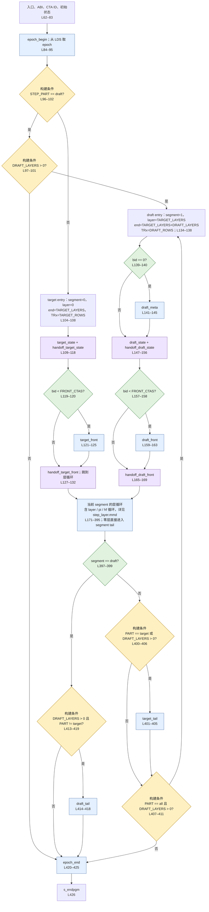
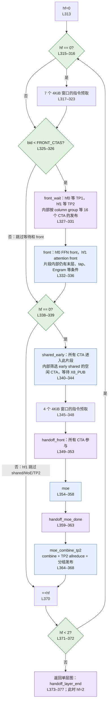

# step.s 的 HIP 风格伪代码与流程图

本文解释当前 `step.s` 的实际控制流。完整伪代码在 [step_pseudocode.hip.cpp](step_pseudocode.hip.cpp)，逐个阶段和关键条件都带有 `ASM Lx-Ly` 注释。

原始 `step.py` 的伪代码见 [step_py_pseudocode.hip.cpp](step_py_pseudocode.hip.cpp)，其注释使用 `PY` 行号；[STEP_PY_EXPLAINED.md](STEP_PY_EXPLAINED.md) 给出两份源码的阶段位置对照。

每个 FlyDSL 片段的完整来源、原函数调用行号和实际定义位置见 [FLYDSL_SOURCE_MAP.md](FLYDSL_SOURCE_MAP.md)。

行号固定于当前 459 行的 [step.s](step.s)，SHA256 为 `f6a49ddeb1dd984dfa97597b1ee83218e6c6f521b580cfc0292f5f78691f45d7`。修改 `step.s` 后需要重新核对行号；它们不是 `step.generated.s` 或最终反汇编的行号。

这里的 HIP 写法用于阅读，没有实现 `STAGE`、硬件寄存器读取和原始 kernarg/LDS 访问等抽象接口，不能直接交给 hipcc 编译。本次只核对文档与源文件，没有构建 kernel、执行单测或启动 GPU。

## 1. 这份汇编实际包含什么

`step.s` 的外层调度可以概括为：入口初始化 → target 或 draft 入口 → 当前段的 layer 循环 → 当前段尾部 → 可选的 draft 段 → epoch 结束。

每层内部还有 index selection 的 `pi` 循环和两个 front 的 `hf` 循环。Engram、indexer、scorer、tap 等由条件分支选择；计算细节放在 `.flydsl.begin/end` 包围的片段里。

例如 L192–196：

```asm
.flydsl.begin attention_A
    .flydsl.function fragments.py:attention_A
    .flydsl.segment both
    .flydsl.abi leaf-ccc-inline
.flydsl.end
```

在伪代码中写成：

```cpp
STAGE(attention_A, S); // ASM L192-L196
```

这表示构建时把该阶段编译得到的 native ASM 插入此位置。它不是运行时设备函数调用，也不是只有一条计算指令。`build.py` 处理 `.flydsl.*`，LLVM assembler 不认识这些自定义指令。插入的阶段保留编译器生成的保存/恢复及 scratch 代码，return 被替换为片段出口跳转。

`.flydsl.segment both` 的阶段可有 target/draft 两套编译变体：两者都可达时，预处理器生成按 `s52` 分流的汇编；只有一套可达时直接插入。target/draft 专用阶段选择固定变体，epoch 两阶段始终使用 target adapter。伪代码用一个 `STAGE` 记号合并表示这些变体选择。

因此 `step.s` 看起来简短，是因为没有展示每个阶段展开后的矩阵计算、内存操作、内部条件和等待循环。最终机器代码的大小不能按这 459 行估算。

## 2. 状态和寄存器怎样对应

| 伪代码字段 | 持续寄存器 | 含义 / 初始化位置 |
| --- | --- | --- |
| `record` | `s36:s37` | 72-byte kernarg 区地址；L64。不是 `fp` 本身。 |
| `bid` | `s38` | clustered dispatch 的逻辑 CTA ID；L71–78。 |
| `tid` | `v40` | CTA 内线程 ID，入口 `v0` 的副本；L65。 |
| `layer` | `s39` | 层表中的绝对层号；target 从 0 开始，draft 从 `TARGET_LAYERS` 开始。 |
| `epoch` | `s48` | 本次 launch 的 TP epoch；先为 0，L89–95 从 scheduler LDS 取回。 |
| `hf` | `s49` | 每层的 front pass，0 或 1；退出循环时为 2。 |
| `pi` | `s50` | index selection pass；只在进入 selection 时重置。 |
| `npass` | `s51` | selection 遍数，当前是 2 或 4。 |
| `segment` | `s52` | 运行时段号：0=target，1=draft。 |
| `end` | `s53` | 当前段结束层号，不包含这一层。 |
| `flags` | `s54` | 当前层 `lflags` 的低 32 位。 |
| `TRx` | `s55` | 当前段的 token 行数。 |
| CCC 栈状态 | `s32/s33/s34/s30:s31` | L66–69 清零，用于保留的 native CCC prologue/epilogue。 |

L36–48 的 `PREP_STAGE` 在预处理展开时放到片段前，准备 `v[0:1]=record, v2=bid, v3=tid, v4=layer, v5=hf, v6=pi, v7=epoch`。

`end/flags/npass/TRx/segment` 是调度器持久字段，没有作为这八个 VGPR 中的额外参数传入。片段自行从 `record` 重建表上下文；target/draft 变体中使用相应的 `TRx`。外层 `flags` 供调度器分支使用，片段内部也会重新读取 `lflags`。

`bid` 的来源也不是简单复制普通 launch 的 `blockIdx.x`。L71–78 读取 `ttmp6/ttmp9/IB_STS2`，在 cluster 模式下计算 `ttmp9 * cluster_width + intra_cluster_id`，否则用 `ttmp9`。完整伪代码保留了这一公式。

`LOAD_LAYER`（L50–60）先从 `record+56` 取得 `fp`，然后读取 `fp + LAYER_TABLE_OFFSET + layer*LAYER_ROW_BYTES + slot` 的 64-bit 值。`lflags` 的调度分支使用低 32 位；`ibat` 的非空检查使用两个 32-bit 半部，等价于检查整个 64-bit 指针。

## 3. 构建条件和运行时条件

| 汇编写法 | HIP 伪代码表达 | 生效时间 |
| --- | --- | --- |
| `.if STEP_PART == 2`，L96–102 | `if constexpr (STEP_PART == DRAFT_ONLY)` | 构建时，按配置保留或删除指令。 |
| `.if DRAFT_LAYERS > 0` 等，L97、400、407、413 | `if constexpr (...)` | 构建时。 |
| `s_cmp_*` / `s_bitcmp1_b32` 加 `STEP_CJMP` | 普通 `if` / 循环条件 | GPU 运行时，读取调度状态或层表。 |
| `.flydsl.segment both` | `STAGE` 的变体选择 | 编译阶段生成可达变体；需要时由运行时 `segment` 分流。 |

`STEP_PART` 为 all=0、target=1、draft=2；`s52` 为 target=0、draft=1。这是两套编号。原 `step.py` 的 kind=1/4 又是另一套位标记，不能直接代入 `s52`。

`STEP_CJMP scc1, label` 在 SCC 为 1 时跳转，`scc0` 在 SCC 为 0 时跳转。例如 L119–120 比较 `bid >= FRONT_CTAS` 并跳过 front，所以伪代码写成执行条件 `if (bid < FRONT_CTAS)`。宏 L20–34 使用相对地址远跳转，避免展开后的阶段超出短分支范围；没有函数调用。

## 4. 从入口到尾部的顺序

### 4.1 每次 launch 的入口与 epoch

L62–83 初始化 ABI 和持久状态。L84–88 的 `epoch_begin` 处理 TP 接收缓冲区的 epoch/parity，并通过新增的 CTA-local LDS 区交接 epoch，L89–95 取回后进入调度。L421–425 的 `epoch_end` 在该 launch 末尾执行，内部由 CTA0/thread0 推进持久 epoch。

`all` 在一个 launch 内完成 target 后接 draft，只有一对 epoch begin/end。split 的 target 和 draft 是两次 launch，各有一对。`draft` 配置且 `DRAFT_LAYERS=0` 时直接从 L96–102 跳到 epoch end，仍然执行这两个阶段。

### 4.2 target/draft 入口

target 入口 L104–132 设置 `[layer,end)=[0,TARGET_LAYERS)`，执行 state 初始化和全设备 handoff，只有 `bid<FRONT_CTAS` 的 CTA 做入口 attention front，之后所有 CTA 参与 front handoff。入口 front 的片段使用原固定表行 44。

draft 入口 L134–169 设置 `[layer,end)=[TARGET_LAYERS,TARGET_LAYERS+DRAFT_LAYERS)`，仅 CTA0 进入 `draft_meta`，随后执行 draft state / handoff 和 front / handoff。draft 入口 front 使用表行 `NL+ndr`。CTA0 的条件并不表示其中所有工作都由 thread0 做，线程分工仍在片段内部。

入口不会重置 `hf/pi`。`hf` 在每层 L313 重置；`pi` 在 L260 重置。跳过 scorer/selection 的层保留上次的 `pi`，伪代码按这一状态行为书写。

### 4.3 一个 layer 的前半段

| 顺序 | `step.s` | 行为 |
| --- | --- | --- |
| 1 | L171–181 | 若 `layer>=end` 直接进尾部，否则读本层 flags 并写开始时间戳。 |
| 2 | L182–201 | target 且 bit7 时做 Engram embedding 量化；然后 attention A 和全设备 handoff。 |
| 3 | L202–216 | target 且 bit7 时生成 Engram KV；然后做 KV/C。 |
| 4 | L217–231 | target 且 bit3 时做 index prepare；随后**无条件**执行 KV/C handoff。 |
| 5 | L232–259 | target 且 bit3 时做 index quant 和 handoff；若 `ibat!=0` 再做 scorer 和 handoff。 |
| 6 | L260–280 | `pi=0`，选择两遍或四遍，每遍 select 后有对应的 handoff。 |
| 7 | L282–311 | attention D/handoff、E/handoff、F，随后 TP1 allreduce 和分组发布。 |

bit7 表示下一层有 Engram：当前层为后续 attention front 准备 embedding/KV。bit3 表示 indexer，bit4 表示 context tap，bit5 表示 candidate producer，bit6 表示 REINDEX。bit1 的 compressor 和 bit2 的 ratio1 条件仍在 index 片段里。原代码注释把 bit0 命名为 special body，当前外层汇编没有对 bit0 的分支。

selection 的遍数和模式如下。L262–263 首先判断 REINDEX，所以 bit6 优先于 bit5。当前 `IDX_LEVELS=2`。

| bit6 / bit5 | `npass` | 片段内的 mode/level |
| --- | --- | --- |
| bit6=1，bit5 任意 | 2 | RX，level=`pi%2`。 |
| bit6=0，bit5=0 | 2 | SEL，level=`pi%2`。 |
| bit6=0，bit5=1 | 4 | pi=0/1 做 SEL，pi=2/3 做 BLK，level=`pi%2`。 |

`index_select` 自行用 `pi` 计算 mode 和 level；外层只控制遍数。`handoff_select` 以 `SELECT0 + pi*4` 选择本遍 counter。`ibat==0` 时跳过整个 score/select 路径，但之前的 quant/handoff 已经执行。

### 4.4 hf 两遍 front 与 MoE

| 行为 | hf=0 | hf=1 | 汇编位置 |
| --- | --- | --- | --- |
| front 指令预取 | 7 个 4KiB 请求 | 跳过 | L315–323 |
| front CTA 的等待 | TP1 column-group counter | TP2 column-group counter | L325–331 |
| front CTA 的计算 | FFN front | 下一层 attention front；段末层写 head 输入 | L332–336，条件在片段内部 |
| early shared | 进入片段，内部筛选 CTA | 跳过 | L338–344 |
| MoE 指令预取 | 4 个 4KiB 请求 | 跳过 | L345–348 |
| front handoff、MoE、MoE handoff、combine/TP2 | 执行 | 跳过 | L349–368 |
| 更新循环变量 | hf 变为 1，再循环 | hf 变为 2，退出 | L370–372 |

当前 `FRONT_CTAS=96`，即 bid=0..95。其他 CTA 在两遍里都跳过 `front_wait/front`，但在 hf0 仍进入 shared/MoE 调度，并参与全设备 handoff。

L340–344 位于 outer `if(hf==0)` 内，所有 CTA 都进入 `shared_early`。片段内部等价于下面的选择，不能把整个阶段移进外层 front CTA 的 `else` 分支再忽略内部条件：

```cpp
// 整段属于 step.s L340-L344；内部条件来自 fragments.py 提取的 step.py L423-L434。
if constexpr (MS.sh_early(ceil_div(TRx, MS.MAXTOK))) {
    if (hf == 0 && bid >= FRONT_CTAS &&
        bid < FRONT_CTAS + ceil_div(TRx, MS.MAXTOK) * MS.NUG * MS.SHE_CTAS) {
        if (tid == 0) wait_count(X8_PUB, FRONT_CTAS); // 原 helper 有超时计数
        __syncthreads();
        MS.ug_shared_early(..., bid - FRONT_CTAS);
    }
}
```

hf0 的 front 内部通过 callback 发布 X8_PUB，使 eligible idle CTA 能在 front 全阶段完成前启动 shared UG；之后 `handoff_front` 把所有 CTA 汇合。两个指令预取区域预取代码，不是 tensor 数据；每条请求使用自身 PC 加相应偏移。

### 4.5 层结束与段尾

L373–377 先做 layer end handoff，再按 target 和 bit4 判断是否做 tap（L378–386），然后 stamp、`++layer`（L388–393）。tap 后没有额外 handoff。L394–395 若还有层，直接回 `.Llayer` 的加载位置。

L398–399 根据运行时 segment 选择 target/draft 尾部。tail 是否插入及是否继续 draft 则是构建条件。

| 构建配置 | launch 中的顺序 |
| --- | --- |
| all，draft layers > 0 | target entry/layers → target tail → draft entry/layers → draft tail → epoch end。 |
| all，draft layers = 0 | target entry/layers → epoch end；**没有 target tail**。 |
| target，draft layers 任意 | target entry/layers → target tail → epoch end。 |
| draft，draft layers > 0 | draft entry/layers → draft tail → epoch end。 |
| draft，draft layers = 0 | epoch begin → epoch end。 |

`TARGET_LAYERS=0` 仍执行 target entry，只跳过 layer body，再按上表判断 tail 和后续段。这里保留的是当前 `step.s` 的行为，没有为了使伪代码看起来常规而更改边界条件。

## 5. 汇编没有直接展示的复杂逻辑

完整的 stage 内部实现仍在 [fragments.py](fragments.py) 和原 [step.py](../atom/models/deepseek_v41/mono/gfx1250/kernels/step.py) 及其 helper 中。

| 外层阶段与位置 | 原 step.py 被提取的行 | 片段内部保留的工作示例 |
| --- | --- | --- |
| `index_prepare`，L221–225 | L320–328 | IQ/IW、compressor 开关、ratio1。 |
| `index_quant`，L236–240 | L332–344 | 量化、compressor crow/cring 和 ratio1。 |
| `index_score/select`，L250–254 / L268–272 | L348–359 / L363–365，select 另有共享 setup | scorer 上下文、RX/SEL/BLK 模式和 level。 |
| `front`，L332–336 | L387–422 | hf 对应的指针选择、段末层/tap 残差处理、Engram gate、X8 发布 callback。 |
| `shared_early`，L340–344 | L423–434 | 构建条件、空闲 CTA 范围、X8_PUB 等待及 CTA barrier。 |
| `moe`，L354–358 | L438–445 | expert 计算调度及 CTA barrier；更深的循环在 moe helpers 内部。 |
| `moe_combine_tp2`，L364–368 | L448–450 | combine、TP allreduce 和分组发布。 |
| `target_tail/draft_tail`，L401–405 / L414–418 | L459–465 / L467–472 | head、采样/verification 或 draft 后续处理。 |

此外，矩阵 tile、global/LDS 操作、TP peer 等待、counter 轮询等可藏在各阶段调用的 helper 里。伪代码没有把这些内部实现全部展开；它逐段完整表达的是 `step.s` 中的外层控制流。

## 6. handoff 不是普通 __syncthreads

入口的 `handoff_target_state/front` 和 `handoff_draft_state/front` 使用 `hdev=False`；层内 handoff 使用 `hdev=True`。两者都是默认等待 256 个 CTA 的 **device-wide counter handoff**。

`hdev` 改变内存顺序实现，不改变同步范围：True 让各 wave 等待 stores，再由 thread0 计数/轮询；False 在 CTA barrier 之后由 thread0 用 release/acquire fences 配合计数/轮询。两者都带 CTA 内 barrier。不能把任何一类 `handoff` 直接翻译成单次 `__syncthreads()`。

`front_wait` 是另一种同步：TP 发布者按 `bid/16` 计数，front CTA 按 `bid%16` 等待对应 column group 到达 16，然后 CTA barrier。它不等待所有 256 CTA，且外层不会让 idle CTA 进入此等待。

counter 等待 helper 内部包含轮询、`s_sleep` 和超时记录，所以一段 handoff 也会展开为分支与循环。本文和流程图描述的是源代码调度意图，不构成 GPU 同步正确性或进度保证。

## 7. 流程图

三张图按总调度、单层和 front 子流程拆分。节点中的 L 编号全部对应 `step.s`。黄色菱形表示构建条件，绿色表示运行时条件，蓝色表示计算阶段，紫色表示同步或包含同步的组合阶段。蓝色节点可能在片段内部还有更多控制流。

独立 Mermaid 源文件：[总图](step_overview.mmd)、[单层图](step_layer.mmd)、[front 图](step_front.mmd)。下面嵌入相同内容，可在支持 Mermaid 的 Markdown 阅读器中查看。

### 7.1 总调度图



### 7.2 单层图

```mermaid
flowchart TD
    CHECK{"入口检查：layer &lt; end?<br/>L171–173"}
    CHECK -- 否 --> TAIL["返回总图的 segment tail<br/>L397"]
    CHECK -- 是 --> LOAD["加载本层 lflags；layer_stamp_start<br/>L175–181"]
    LOAD --> EQ{"target 且 bit7?<br/>L182–185"}
    EQ -- 是 --> ENGQ["engq<br/>L186–190"]
    EQ -- 否 --> A
    ENGQ --> A["attention_A + handoff_A<br/>L192–201"]
    A --> EK{"target 且 bit7?<br/>L202–205"}
    EK -- 是 --> ENGKV["engkv<br/>L206–210"]
    EK -- 否 --> KV
    ENGKV --> KV["kv_C<br/>L212–216"]
    KV --> IP{"target 且 bit3?<br/>L217–220"}
    IP -- 是 --> PREP["index_prepare<br/>L221–225"]
    IP -- 否 --> KH
    PREP --> KH["handoff_KV_C：无条件汇合<br/>L227–231"]
    KH --> IQ{"target 且 bit3?<br/>L232–235"}
    IQ -- 否 --> D
    IQ -- 是 --> QUANT["index_quant + handoff_quant<br/>L236–245"]
    QUANT --> IB{"ibat 的 64-bit 值 != 0?<br/>L246–249"}
    IB -- 否 --> D
    IB -- 是 --> SCORE["index_score + handoff_score<br/>L250–259"]
    SCORE --> P0["pi=0；npass=IDX_LEVELS=2<br/>L260–261"]
    P0 --> RX{"bit6：REINDEX?<br/>L262–263"}
    RX -- 是 --> SEL
    RX -- 否 --> PROD{"bit5：candidate producer?<br/>L264–265"}
    PROD -- 否 --> SEL
    PROD -- 是 --> P4["npass=2*IDX_LEVELS=4<br/>L266"]
    P4 --> SEL["index_select + handoff_select<br/>L267–277"]
    SEL --> PI["++pi<br/>L278"]
    PI --> MOREP{"pi &lt; npass?<br/>L279–280"}
    MOREP -- 是 --> SEL
    MOREP -- 否 --> D["attention_D + handoff_D<br/>L282–291"]
    D --> E["attention_E + handoff_E<br/>L292–301"]
    E --> F["attention_F + tp1<br/>L302–311"]
    F --> FRONT["两遍 front 子流程，详见 step_front.mmd<br/>hf=0：FFN/MoE/TP2；hf=1：下一层 attention front<br/>L313–372"]
    FRONT --> LH["handoff_layer_end<br/>L373–377"]
    LH --> TAPC{"target 且 bit4?<br/>L378–381"}
    TAPC -- 是 --> TAP["tap<br/>L382–386"]
    TAPC -- 否 --> STAMP
    TAP --> STAMP["layer_stamp_end；++layer<br/>L388–393"]
    STAMP --> MOREL{"layer &lt; end?<br/>L394–395"}
    MOREL -- 是 --> LOAD
    MOREL -- 否 --> TAIL
    classDef runtime fill:#e1f3df,stroke:#34733a,color:#222;
    classDef stage fill:#e4efff,stroke:#466fa7,color:#222;
    classDef sync fill:#efe4ff,stroke:#7a50a0,color:#222;
    class CHECK,EQ,EK,IP,IQ,IB,RX,PROD,MOREP,TAPC,MOREL runtime;
    class ENGQ,ENGKV,KV,PREP,FRONT,TAP stage;
    class A,KH,QUANT,SCORE,SEL,D,E,F,LH sync;
```



### 7.3 两遍 front 图


